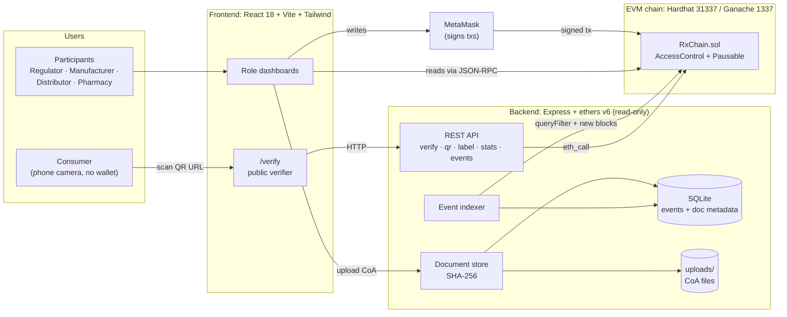
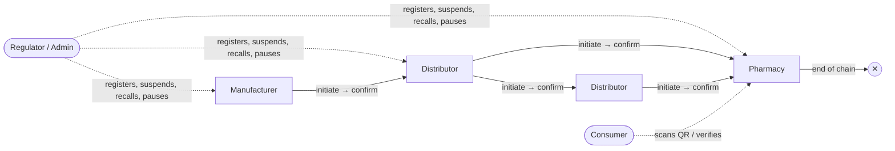
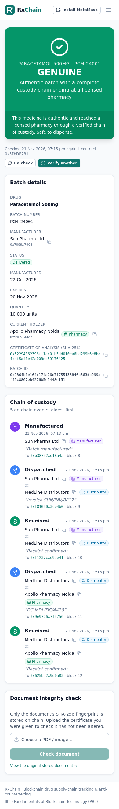
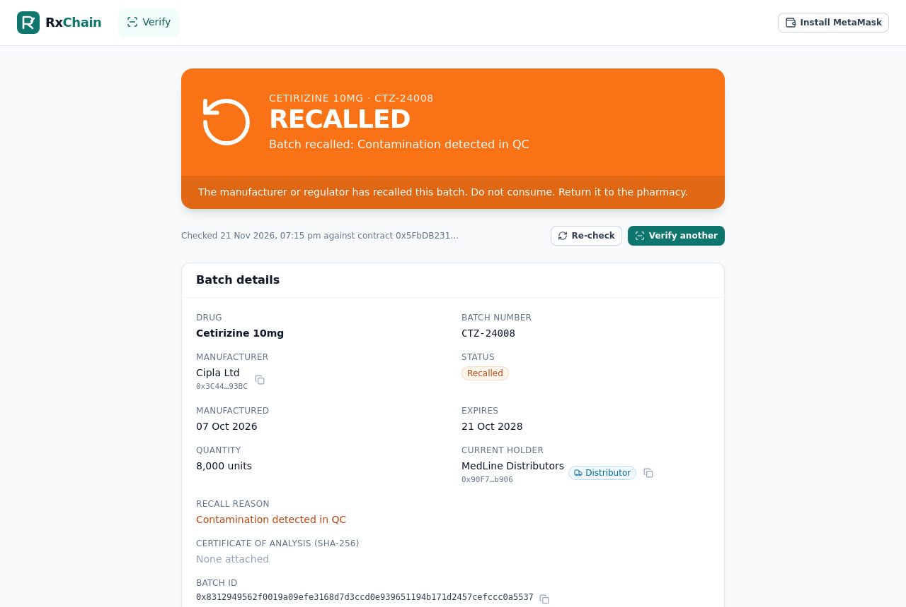
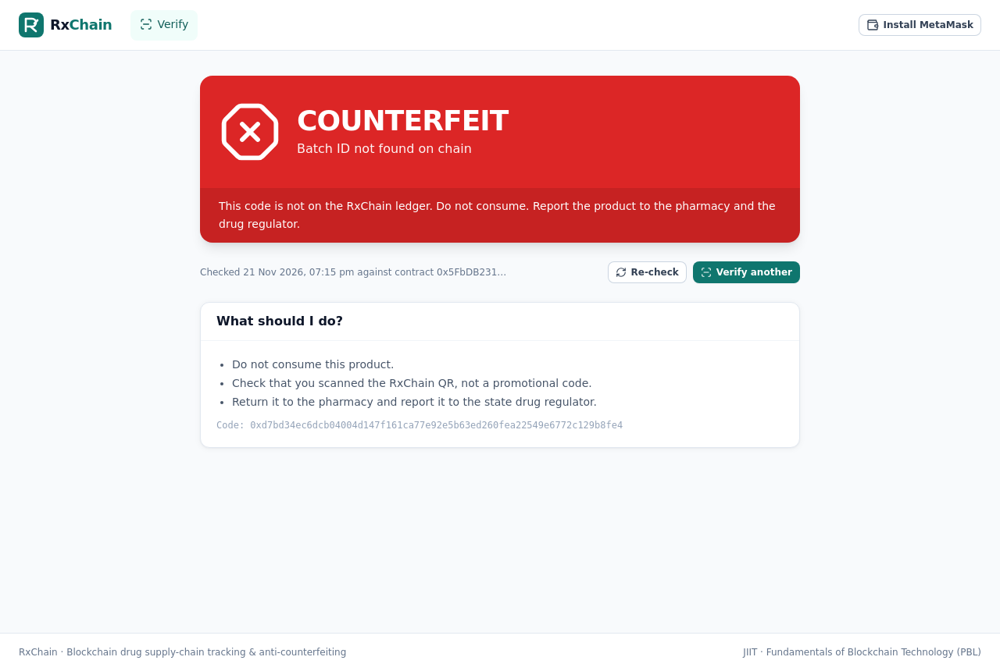
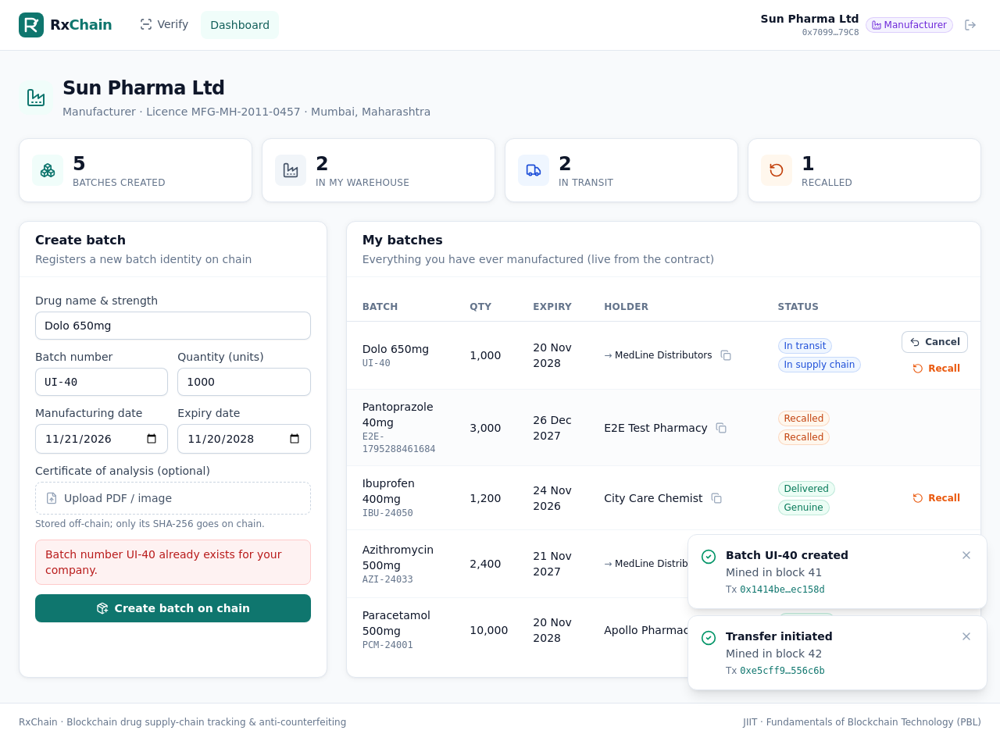
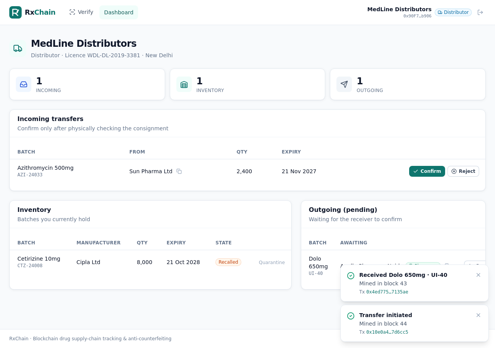
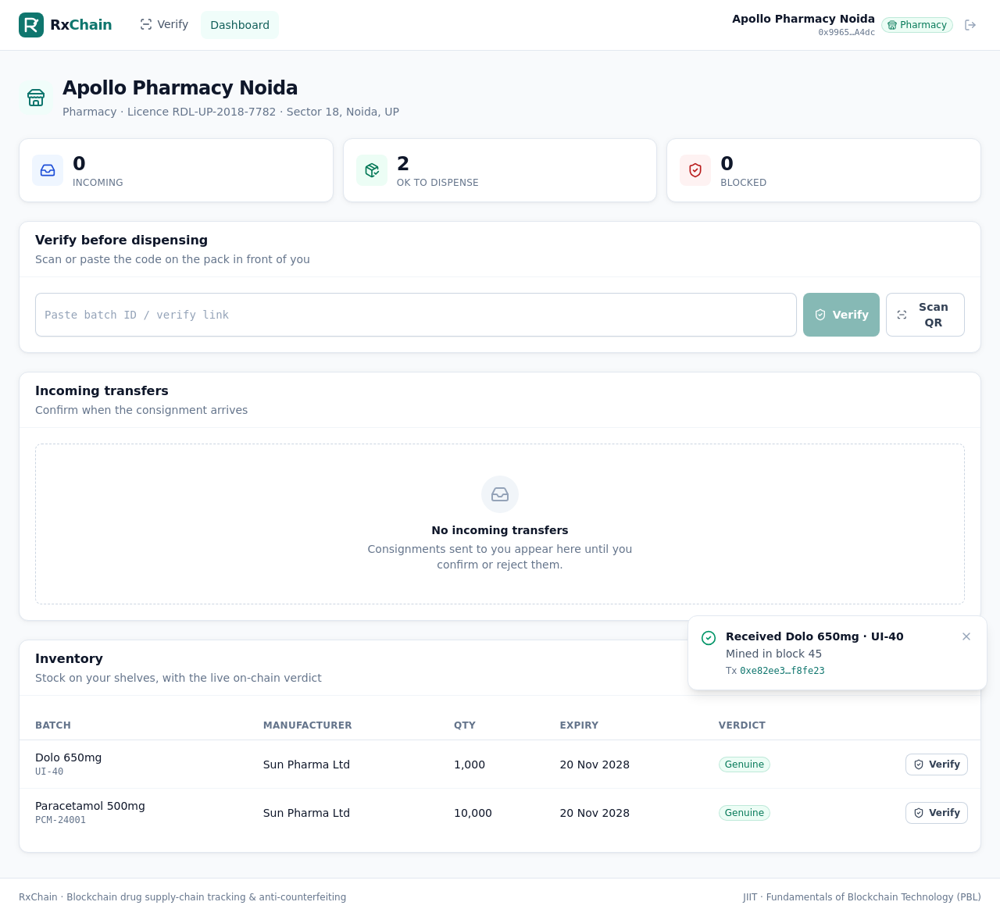
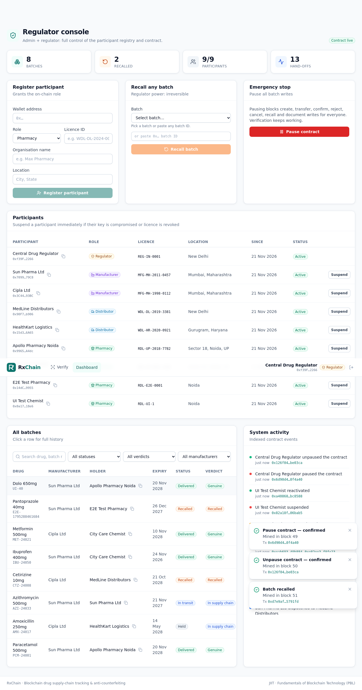
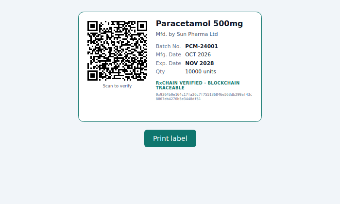

# RxChain: Blockchain Drug Supply-Chain Tracking & Anti-Counterfeiting

RxChain gives every drug batch a **tamper-proof on-chain identity** and records its full **chain of custody**: Manufacturer → Distributor(s) → Pharmacy. A QR code on the packaging links the physical product to its on-chain record. **Anyone can scan it, with no wallet needed,** and get one of these verdicts:

| Verdict             | Colour    | Meaning                                                                                                |
| ------------------- | --------- | ------------------------------------------------------------------------------------------------------ |
| **GENUINE**         | 🟢 green  | Authentic, complete custody chain ending at an active licensed pharmacy                                |
| **COUNTERFEIT**     | 🔴 red    | Batch ID does not exist on chain (or the QR is not an RxChain code)                                    |
| **SUSPICIOUS**      | 🔴 red    | Exists, but the manufacturer or current custodian is suspended, or the custody history is inconsistent |
| **RECALLED**        | 🟠 orange | Recalled by the manufacturer or a regulator (reason shown)                                             |
| **EXPIRED**         | ⚪ gray   | Past its expiry date                                                                                   |
| **IN SUPPLY CHAIN** | 🔵 blue   | Authentic, but not yet received by a pharmacy                                                          |

Built for the JIIT **Fundamentals of Blockchain Technology** PBL.

---

## Contents

1. [Architecture](#architecture)
2. [Roles and flow](#roles-and-flow)
3. [Tech stack](#tech-stack)
4. [Prerequisites](#prerequisites)
5. [Setup and run](#setup-and-run)
6. [MetaMask setup](#metamask-setup)
7. [5-minute demo walkthrough](#5-minute-demo-walkthrough)
8. [Screenshots](#screenshots)
9. [API reference](#api-reference)
10. [Smart-contract reference](#smart-contract-reference)
11. [Tests and coverage](#tests-and-coverage)
12. [Project structure](#project-structure)
13. [Troubleshooting](#troubleshooting)
14. [Limitations and future work](#limitations-and-future-work)

More docs: [`docs/ARCHITECTURE.md`](docs/ARCHITECTURE.md) (on/off-chain split, state machine, sequence diagrams, design decisions) · [`docs/SECURITY.md`](docs/SECURITY.md) (threat model) · [`docs/SYSTEM_WORKFLOW.md`](docs/SYSTEM_WORKFLOW.md) (system workflow diagram for synopsis §6).

---

## Architecture



- **All writes are signed in MetaMask** by the participant. The backend never holds participant keys.
- **On chain:** identities, roles, batch records, custody history, verdict logic, document _hashes_.
- **Off chain:** the documents themselves, QR/label rendering, and an event index for fast activity feeds.

## Roles and flow



| Role                             | Can do                                                                                                             |
| -------------------------------- | ------------------------------------------------------------------------------------------------------------------ |
| **Admin / Regulator** (deployer) | Register participants, suspend/reactivate them, pause/unpause the contract, recall **any** batch                   |
| **Manufacturer**                 | Create batches, attach CoA hashes, transfer to distributors only, cancel own pending transfers, recall own batches |
| **Distributor**                  | Confirm/reject incoming, forward to a distributor or pharmacy, cancel pending                                      |
| **Pharmacy**                     | Confirm/reject incoming. End of the chain: cannot transfer further                                                 |
| **Consumer**                     | Verify any batch: no wallet, no login                                                                              |

Every transfer is **two-step** (sender initiates, receiver confirms), so custody never moves without the receiver's signature.

## Tech stack

| Layer            | Technology                                                                                                                             |
| ---------------- | -------------------------------------------------------------------------------------------------------------------------------------- |
| Smart contract   | Solidity 0.8.24, OpenZeppelin Contracts 5.1 (`AccessControl`, `Pausable`), custom errors, NatSpec                                      |
| Contract tooling | Hardhat 2 (TypeScript), hardhat-toolbox (ethers v6, chai, TypeChain, solidity-coverage, hardhat-gas-reporter)                          |
| Local chain      | `npx hardhat node` (chainId 31337); `ganache` network entry (port 7545, chainId 1337)                                                  |
| Backend          | Node 20, Express 4, TypeScript, ethers v6, `qrcode`, multer, Node `crypto` SHA-256, better-sqlite3, zod, helmet, cors, morgan          |
| Frontend         | React 18, Vite 5, TypeScript, TailwindCSS 3, ethers v6, react-router 6, html5-qrcode, qrcode.react, lucide-react icons                 |
| Wallet           | MetaMask (EIP-1193, `wallet_addEthereumChain`)                                                                                         |
| Testing          | Hardhat/Mocha/Chai (contract), Jest + supertest against a real Hardhat node (backend), `tsc` + Vite build (frontend), `scripts/e2e.ts` |
| Ops              | npm workspaces monorepo, `concurrently`, Docker Compose                                                                                |

## Prerequisites

- **Node.js 20+** and npm 10+ (`node -v`)
- **Git**
- **MetaMask** browser extension (for the dashboards; verification needs nothing)
- Optional: **Docker** + Docker Compose v2
- Optional: Ganache 7 (instead of the Hardhat node)

## Setup and run

```bash
git clone <this repo> RxChain && cd RxChain
npm run setup                          # installs all workspaces
cp backend/.env.example backend/.env   # optional: defaults work out of the box
cp frontend/.env.example frontend/.env # optional
npm run demo                           # chain → deploy → seed → backend + frontend
```

Open **http://localhost:5173**. `npm run demo` prints every demo account (address + private key) and every seeded batch ID with its verdict. Stop with **Ctrl-C**.

### Running the pieces separately

| Command            | What it does                                                                                              |
| ------------------ | --------------------------------------------------------------------------------------------------------- |
| `npm run chain`    | Hardhat node on `0.0.0.0:8545` (chainId 31337). Leave running                                             |
| `npm run deploy`   | Compile and deploy; writes `frontend/src/contracts/RxChain.json` and `backend/src/contracts/RxChain.json` |
| `npm run seed`     | Register the 6 demo participants and create 6 demo batches (idempotent)                                   |
| `npm run expire`   | Advance chain time past batch #5's expiry → it becomes **EXPIRED**                                        |
| `npm run e2e`      | Full scripted flow with real signed transactions (see [tests](#tests-and-coverage))                       |
| `npm run dev`      | Backend (`:4000`) and frontend (`:5173`) together                                                         |
| `npm test`         | Contract tests → backend tests → frontend type-check and production build                                 |
| `npm run coverage` | Solidity coverage report (`contracts/coverage/index.html`)                                                |
| `npm run lint`     | ESLint (backend + frontend) + `tsc` + Prettier check                                                      |

### Docker

```bash
docker compose up --build
```

Starts `chain` (8545), a one-shot `deployer` (deploy + seed), `backend` (4000) and `frontend` (5173, production build). The seeded accounts are the same Hardhat defaults listed below.

### Ganache

Start Ganache on port **7545** with chainId **1337** and enough accounts, then `npm run deploy:ganache && npm run seed:ganache`. Set `RPC_URL=http://127.0.0.1:7545` in `backend/.env`, and `VITE_RPC_URL` / `VITE_WALLET_RPC_URL` to the same in `frontend/.env`. The contract targets the `paris` EVM so it runs on Ganache's hardfork.

### Verifying from a phone

The QR encodes `${PUBLIC_APP_URL}/verify/<batchId>`. To scan with a phone on the same Wi-Fi, set `PUBLIC_APP_URL=http://<your-LAN-IP>:5173` in `backend/.env` and open the frontend via the LAN IP. The frontend reaches the API and RPC on the same host automatically. Phone cameras open the link directly. The in-page camera scanner needs HTTPS or `localhost`; the _Upload QR_ and _Paste ID_ tabs work everywhere.

## MetaMask setup

1. **Add the network**: MetaMask → _Networks_ → _Add network manually_:
   - Network name: `Hardhat Localhost`
   - RPC URL: `http://127.0.0.1:8545`
   - Chain ID: `31337`
   - Currency symbol: `ETH`

   (Or just click **Connect Wallet**: the app asks MetaMask to add or switch to it via `wallet_addEthereumChain`.)

2. **Import the demo accounts**: _Account menu → Add account → Import account → paste private key_. Name each one as below.

> ⚠️ These are Hardhat's **public, well-known** test keys. Never send real funds to them or use them on a real network.

| #   | Label in MetaMask               | Role                                     | Address                                      | Private key                                                          |
| --- | ------------------------------- | ---------------------------------------- | -------------------------------------------- | -------------------------------------------------------------------- |
| 0   | RxChain – Regulator (Admin)     | Admin + Regulator                        | `0xf39Fd6e51aad88F6F4ce6aB8827279cffFb92266` | `0xac0974bec39a17e36ba4a6b4d238ff944bacb478cbed5efcae784d7bf4f2ff80` |
| 1   | RxChain – Sun Pharma Ltd        | Manufacturer                             | `0x70997970C51812dc3A010C7d01b50e0d17dc79C8` | `0x59c6995e998f97a5a0044966f0945389dc9e86dae88c7a8412f4603b6b78690d` |
| 2   | RxChain – Cipla Ltd             | Manufacturer                             | `0x3C44CdDdB6a900fa2b585dd299e03d12FA4293BC` | `0x5de4111afa1a4b94908f83103eb1f1706367c2e68ca870fc3fb9a804cdab365a` |
| 3   | RxChain – MedLine Distributors  | Distributor                              | `0x90F79bf6EB2c4f870365E785982E1f101E93b906` | `0x7c852118294e51e653712a81e05800f419141751be58f605c371e15141b007a6` |
| 4   | RxChain – HealthKart Logistics  | Distributor                              | `0x15d34AAf54267DB7D7c367839AAf71A00a2C6A65` | `0x47e179ec197488593b187f80a00eb0da91f1b9d0b13f8733639f19c30a34926a` |
| 5   | RxChain – Apollo Pharmacy Noida | Pharmacy                                 | `0x9965507D1a55bcC2695C58ba16FB37d819B0A4dc` | `0x8b3a350cf5c34c9194ca85829a2df0ec3153be0318b5e2d3348e872092edffba` |
| 6   | RxChain – City Care Chemist     | Pharmacy                                 | `0x976EA74026E726554dB657fA54763abd0C3a0aa9` | `0x92db14e403b83dfe3df233f83dfa3a0d7096f21ca9b0d6d6b8d88b2b4ec1564e` |
| 9   | RxChain – Unregistered          | none (shows the "Not registered" screen) | `0xa0Ee7A142d267C1f36714E4a8F75612F20a79720` | `0x2a871d0798f97d79848a013d4936a73bf4cc922c825d33c1cf7073dff6d409c6` |

After restarting the chain, reset MetaMask's nonce cache: _Settings → Advanced → Clear activity tab data_.

## 5-minute demo walkthrough

The seeded batch IDs are deterministic (`keccak256(manufacturer, batchNumber)`), so these links work after every fresh `npm run demo`:

| Verdict                                  | Batch                          | Verify link                                                                                     |
| ---------------------------------------- | ------------------------------ | ----------------------------------------------------------------------------------------------- |
| GENUINE                                  | Paracetamol 500mg · PCM-24001  | http://localhost:5173/verify/0x9364b0e164c17fa26c7f755136846e563db299af43c8867eb4276b5e3448df51 |
| IN SUPPLY CHAIN (held)                   | Amoxicillin 250mg · AMX-24017  | http://localhost:5173/verify/0x7b8d86d3bf27336cd5acea5d936b99175f27e4e6448fc0941b47580d82661cda |
| IN SUPPLY CHAIN (pending)                | Azithromycin 500mg · AZI-24033 | http://localhost:5173/verify/0xde3d3e525cb477c05e9d5d7f7f924cf9a6e537d30635aa95a41521139c7b19cf |
| RECALLED                                 | Cetirizine 10mg · CTZ-24008    | http://localhost:5173/verify/0x8312949562f0019a09efe3168d7d3ccd0e939651194b171d2457cefccc0a5537 |
| GENUINE → EXPIRED after `npm run expire` | Ibuprofen 400mg · IBU-24050    | http://localhost:5173/verify/0x9d746a47f99325692dd62b9d752d247a48318f6f2e50cf270ac23f540559b1c9 |
| GENUINE (D → D → P)                      | Metformin 500mg · MET-24021    | http://localhost:5173/verify/0x3208750cedcb1e769837152948c7d897a69ec44e404493318370729fa8cccf52 |
| COUNTERFEIT                              | random ID                      | http://localhost:5173/verify/0xd7bd34ec6dcb04004d147f161ca77e92e5b63ed260fea22549e6772c129b8fe4 |

**Script (about 5 minutes):**

1. **Landing (0:00)**: open http://localhost:5173. Point out the live ledger stats and the activity feed.
2. **Consumer verify (0:30)**: click **Verify a Medicine** → _Paste ID_ → paste the GENUINE ID. Show the green banner and the custody timeline (Sun Pharma → MedLine → Apollo, each hop with role badge, time, note, tx link). Under **Document integrity check**, upload `samples/CoA-PCM-24001.pdf` → _matches_; upload `samples/CoA-PCM-24001-TAMPERED.pdf` → _does NOT match_.
3. **Other verdicts (1:30)**: open the RECALLED link (orange, reason "Contamination detected in QC"), the IN SUPPLY CHAIN link (blue), and the COUNTERFEIT link (red). Try _Upload QR_ with a QR PNG from step 4.
4. **Manufacturer (2:15)**: switch MetaMask to **Sun Pharma** → _Dashboard_. Create a batch (e.g. `Dolo 650mg`, `DOLO-001`, attach the sample CoA). Confirm in MetaMask and watch the pending → mined toast. The QR appears; click **Download PNG** / **Print label**. In _My batches_ click **Transfer** → the dropdown lists only distributors → choose **MedLine**.
5. **Distributor (3:15)**: switch to **MedLine** → _Incoming transfers_ → **Confirm**. In _Inventory_ click **Forward** → **Apollo Pharmacy Noida**.
6. **Pharmacy (3:45)**: switch to **Apollo** → **Confirm**. The inventory shows **Genuine**. Click **Verify** → the public page is GENUINE.
7. **Regulator (4:15)**: switch to **Regulator** → _Recall any batch_ → select `DOLO-001` → reason → recall. Re-verify: **RECALLED**. Optionally suspend **Sun Pharma** in _Participants_ → its delivered batches now verify as **SUSPICIOUS**; reactivate. Show **Pause contract**.
8. **Expiry (4:45)**: in a terminal run `npm run expire`, then reload the Ibuprofen link → **EXPIRED**.
9. **Illegal flows** (if asked): as Sun Pharma, try to transfer to a pharmacy (not offered in the UI; the contract would revert `InvalidTransferRoute`); as an unregistered wallet, open `/manufacturer` → _Not registered — ask the regulator_.

## Screenshots

> Captured from the seeded demo (`npm run demo`). Replace the files in `docs/screenshots/` to update them.

|                          |                                                                |
| ------------------------ | -------------------------------------------------------------- |
| Landing                  |                        |
| Verify: Genuine (mobile) |   |
| Verify: Recalled         |        |
| Verify: Counterfeit      |  |
| Manufacturer dashboard   |              |
| Distributor dashboard    |                |
| Pharmacy dashboard       |                      |
| Regulator console        |                            |
| Printable label          |                            |

## API reference

Base URL `http://localhost:4000`. All responses are JSON unless noted. Errors: `{ "error": string, "details"?: any }`.

| Method & path                                    | Description                                                                                                                                                                                                   |
| ------------------------------------------------ | ------------------------------------------------------------------------------------------------------------------------------------------------------------------------------------------------------------- |
| `GET /api/health`                                | Chain reachability, contract address and deployment, indexer cursor. `200` ok / `503` degraded                                                                                                                |
| `GET /api/verify/:batchId`                       | **Public verdict.** Calls `verifyBatch`, `getBatch`, `getHistory`, adds tx hashes from the index and participant names. Malformed or unknown IDs return `COUNTERFEIT`, never a 500                            |
| `GET /api/qr/:batchId.png`                       | QR PNG encoding `${PUBLIC_APP_URL}/verify/<id>`. `?size=128..2048`, `?download` for an attachment. `404` if the batch does not exist                                                                          |
| `GET /api/qr/:batchId.svg`                       | Same, as SVG                                                                                                                                                                                                  |
| `GET /api/label/:batchId`                        | Printable HTML packaging label (QR, drug, batch no., mfg/exp, manufacturer, quantity)                                                                                                                         |
| `POST /api/documents`                            | `multipart/form-data` field `file` (≤ `MAX_UPLOAD_MB`). Stores it under `backend/uploads`, returns `{hash:"0x…", fileId, originalName, mimeType, size, url}`. Pass `hash` to `createBatch` / `attachDocument` |
| `GET /api/documents/:hash`                       | Returns the stored file (header `X-Content-SHA256`)                                                                                                                                                           |
| `GET /api/documents/:hash/meta`                  | Stored document metadata                                                                                                                                                                                      |
| `POST /api/documents/verify`                     | Fields `file` + `batchId`. Recomputes SHA-256 and compares it with the on-chain `docHash` → `{match, computedHash, onChainHash, message}`                                                                     |
| `GET /api/stats`                                 | Batches by status (+ expired count), participants by role, confirmed hand-offs, pause state, 15 most recent events                                                                                            |
| `GET /api/events?batchId=&address=&name=&limit=` | Indexed activity feed (newest first). `address` matches either party                                                                                                                                          |

Example verify response (truncated):

```json
{
  "batchId": "0x9364…df51",
  "verdict": "GENUINE",
  "reason": "Authentic batch with a complete custody chain ending at a licensed pharmacy",
  "batch": {
    "drugName": "Paracetamol 500mg",
    "batchNumber": "PCM-24001",
    "status": "Delivered",
    "docHash": "0x3229…6425",
    "...": "..."
  },
  "history": [
    {
      "eventType": "Created",
      "from": null,
      "to": "0x7099…79C8",
      "timestamp": 1795285829,
      "note": "Batch manufactured",
      "txHash": "0xc1fc…f896",
      "blockNumber": 8
    }
  ],
  "participants": {
    "0x7099…79C8": { "name": "Sun Pharma Ltd", "role": "Manufacturer", "active": true }
  }
}
```

Backend environment (`backend/.env.example`): `PORT`, `RPC_URL`, `PUBLIC_APP_URL`, `CORS_ORIGIN`, `CONTRACT_FILE`, `DATABASE_FILE`, `UPLOADS_DIR`, `SAMPLES_DIR`, `MAX_UPLOAD_MB`, `INDEXER_POLL_MS`.

## Smart-contract reference

`contracts/contracts/RxChain.sol`. Enums: `Role {None, Manufacturer, Distributor, Pharmacy, Regulator}`, `BatchStatus {Created, InTransit, Delivered, Recalled}`, `EventType {Created, TransferInitiated, TransferConfirmed, TransferCancelled, TransferRejected, Recalled, DocumentAttached}`, `Verdict {Genuine, Counterfeit, Suspicious, Recalled, Expired, InSupplyChain}`.

| Function                                                                                                                                                                                                           | Access                                       | Description                                                                                                                            |
| ------------------------------------------------------------------------------------------------------------------------------------------------------------------------------------------------------------------ | -------------------------------------------- | -------------------------------------------------------------------------------------------------------------------------------------- |
| `constructor(name, licenseId, location)`                                                                                                                                                                           | deployer                                     | Deployer gets `DEFAULT_ADMIN_ROLE` and is registered as an active Regulator                                                            |
| `registerParticipant(addr, role, name, licenseId, location)`                                                                                                                                                       | admin                                        | Registers and grants the matching role                                                                                                 |
| `setParticipantActive(addr, active)`                                                                                                                                                                               | admin                                        | Suspend or reactivate                                                                                                                  |
| `pause()` / `unpause()`                                                                                                                                                                                            | admin                                        | Emergency stop for all batch writes                                                                                                    |
| `createBatch(drugName, batchNumber, mfgDate, expiryDate, quantity, docHash)`                                                                                                                                       | active manufacturer                          | ID = `keccak256(abi.encodePacked(manufacturer, batchNumber))`. Requires `expiry > mfg`, `expiry > now`, `mfg ≤ now + 1 day`, `qty > 0` |
| `initiateTransfer(id, to, note)`                                                                                                                                                                                   | active current owner                         | Routes: M→D, D→D, D→P only. Receiver active; no pending; not recalled or expired                                                       |
| `confirmReceipt(id)`                                                                                                                                                                                               | active pending owner                         | Custody moves; status Delivered at a pharmacy, else Created ("held"). Blocked if expired                                               |
| `rejectTransfer(id, reason)`                                                                                                                                                                                       | active pending owner                         | Clears pending; status back to Created                                                                                                 |
| `cancelTransfer(id)`                                                                                                                                                                                               | active current owner                         | Clears pending; status back to Created                                                                                                 |
| `recallBatch(id, reason)`                                                                                                                                                                                          | batch manufacturer or any regulator (active) | Irreversible; clears any pending transfer                                                                                              |
| `attachDocument(id, docHash)`                                                                                                                                                                                      | batch manufacturer (active)                  | Sets or replaces the CoA SHA-256                                                                                                       |
| `verifyBatch(id) → (Verdict, reason)`                                                                                                                                                                              | view, public                                 | Core anti-counterfeit logic (see [flowchart](docs/ARCHITECTURE.md#verdict-decision-flowchart))                                         |
| `getBatch`, `getHistory`, `getBatchesByOwner`, `getBatchesByManufacturer`, `getPendingIncoming`, `getAllBatchIds`, `totalBatches`, `getParticipant`, `getAllParticipants`, `isActiveParticipant`, `computeBatchId` | view                                         | Read helpers                                                                                                                           |

**Events:** `ParticipantRegistered`, `ParticipantStatusChanged`, `BatchCreated`, `TransferInitiated`, `TransferConfirmed`, `TransferRejected`, `TransferCancelled`, `BatchRecalled`, `DocumentAttached` (plus OpenZeppelin's `RoleGranted`, `RoleRevoked`, `Paused`, `Unpaused`).

**Custom errors:** `ZeroAddress`, `InvalidRole`, `EmptyField`, `AlreadyRegistered`, `NotRegistered`, `NotActiveParticipant`, `BatchAlreadyExists`, `BatchNotFound`, `InvalidDates`, `InvalidQuantity`, `NotCurrentOwner`, `NotPendingOwner`, `TransferAlreadyPending`, `NoPendingTransfer`, `BatchIsRecalled`, `BatchIsExpired`, `SelfTransfer`, `ReceiverNotActive`, `InvalidTransferRoute(fromRole,toRole)`, `NotAuthorizedToRecall`, `NotBatchManufacturer`, `InvalidDocHash` (+ OZ `AccessControlUnauthorizedAccount`, `EnforcedPause`). The frontend decodes each one into a readable message.

**Gas** (Hardhat, optimizer 200 runs; from `hardhat-gas-reporter`):

| Method                              | Avg gas                     |
| ----------------------------------- | --------------------------- |
| Deployment                          | ~3.92 M                     |
| `registerParticipant`               | ~197 k                      |
| `createBatch`                       | ~420–490 k (string storage) |
| `initiateTransfer`                  | ~174–212 k                  |
| `confirmReceipt`                    | ~166–197 k                  |
| `rejectTransfer` / `cancelTransfer` | ~114 k / ~112 k             |
| `recallBatch`                       | ~142–159 k                  |
| `attachDocument`                    | ~219 k                      |
| `setParticipantActive`              | ~33 k                       |

## Tests and coverage

| Suite                                                                        | Command                                                      | Result                                                                                                                                                    |
| ---------------------------------------------------------------------------- | ------------------------------------------------------------ | --------------------------------------------------------------------------------------------------------------------------------------------------------- |
| Smart contract (Mocha/Chai, 56 tests)                                        | `npm test -w contracts`                                      | ✅ 56 passing                                                                                                                                             |
| Solidity coverage                                                            | `npm run coverage`                                           | **100 % statements · 100 % branches · 100 % functions · 100 % lines** (`RxChain.sol`)                                                                     |
| Backend API (Jest + supertest, 37 tests, real Hardhat node in `globalSetup`) | `npm test -w backend`                                        | ✅ 37 passing                                                                                                                                             |
| Frontend                                                                     | `npm run typecheck -w frontend && npm run build -w frontend` | ✅ 0 type errors, production build OK                                                                                                                     |
| End-to-end                                                                   | `npm run e2e` (chain deployed + seeded)                      | ✅ register → create → transfer → confirm → forward → confirm → **Genuine** → recall → **Recalled** (also checked through the API when the backend is up) |

The contract suite covers role gating on every function (including suspended participants and revoked roles), duplicate and invalid input, the full M→D→P path with the verdict at each stage, D→D hops, every illegal route (M→P, P→anyone, unregistered or suspended receiver, non-owner, non-pending confirmer, double initiate), reject/cancel restoring state, recall by manufacturer and by regulator, expiry via `time.increase`, random IDs → Counterfeit, pause, history order and fields, and the history-integrity check. The integrity check is exercised through a test-only harness contract (`contracts/contracts/test/RxChainHarness.sol`) that corrupts stored history, because the production contract cannot produce an inconsistent history.

## Project structure

```
RxChain/
├── contracts/              Hardhat workspace
│   ├── contracts/RxChain.sol
│   ├── contracts/test/RxChainHarness.sol   (test-only)
│   ├── scripts/            deploy · seed · expire · e2e · lib
│   └── test/RxChain.test.ts
├── backend/                Express API
│   ├── src/{app,index,config,context,types}.ts
│   ├── src/routes/         health · verify · qr · label · documents · stats · events
│   ├── src/services/       chain · indexer · eventStore · documents · db
│   └── test/               globalSetup (starts Hardhat) · api.test.ts
├── frontend/               React app
│   └── src/{pages,components,hooks,lib}
├── samples/                Demo CoA PDFs (genuine + tampered)
├── scripts/demo.mjs        One-command demo orchestrator
├── docs/                   ARCHITECTURE · SECURITY · SYSTEM_WORKFLOW
├── Dockerfile · docker-compose.yml
└── package.json            npm workspaces + root scripts
```

## Troubleshooting

| Symptom                                                          | Fix                                                                                                              |
| ---------------------------------------------------------------- | ---------------------------------------------------------------------------------------------------------------- |
| MetaMask: _nonce too high_ / tx stuck after restarting the chain | _Settings → Advanced → Clear activity tab data_                                                                  |
| "Contract not found at the configured address"                   | The chain was restarted: run `npm run deploy && npm run seed` (the backend reloads the deployment automatically) |
| Port 8545/4000/5173 in use                                       | Stop the other process; `npm run demo` reuses an already-running chain on 8545                                   |
| Camera does not start on a phone                                 | The in-page scanner needs HTTPS or localhost; use the phone's camera app on the QR, or _Upload QR_               |
| `better-sqlite3` build errors                                    | Use Node 20 LTS; on Linux install `python3 make g++`                                                             |

## Limitations and future work

- **Public test chain only.** A production pharma network should run on a **permissioned EVM chain such as Hyperledger Besu** (IBFT/QBFT consensus, node permissioning, private transactions), or on an L2 rollup for public auditability with low fees. The contract is chain-agnostic.
- **Batch-level, not unit-level.** One QR per batch means a cloned label verifies until the batch is recalled. Next steps: **serialised unit IDs** (one ID per strip or box, aggregated into cartons) with _first-scan / scan-count_ tracking, plus **tamper-evident seals**. See [SECURITY.md](docs/SECURITY.md).
- **Cold chain.** Vaccines and biologics need **IoT temperature and humidity loggers** that sign readings and anchor them on chain per hop, with automatic `SUSPICIOUS` on an excursion.
- **Regulatory alignment.** India's **QR traceability mandate** (Drugs Rules amendments: QR codes on active pharmaceutical ingredients from 1 Jan 2023 and on the top-300 formulation brands from 1 Aug 2023) already prescribes a unique product code, batch number, manufacturing and expiry dates, and manufacturer details: exactly the fields RxChain stores. A next step is mapping to **GS1** identifiers (GTIN + serial + lot + expiry) and integrating with the national track-and-trace portal.
- **Comparison with MediLedger.** MediLedger (US DSCSA) uses a permissioned network where trading partners verify product identifiers and returns _without exposing commercial data_, using private data and zero-knowledge-style checks. RxChain is a transparent, public-verification teaching implementation: all custody data is public. A production design would keep identities and verdicts public but move commercial details (quantities, prices, counterparties) off chain or into private transactions.
- **Key management.** Organisations would use hardware wallets, multisig (e.g. Safe) for admin, and role-based key rotation instead of single EOAs.
- **Scalability.** Enumerations such as `getAllBatchIds` are fine for a demo, but large deployments should paginate and rely on the off-chain indexer (already provided) for listings.
