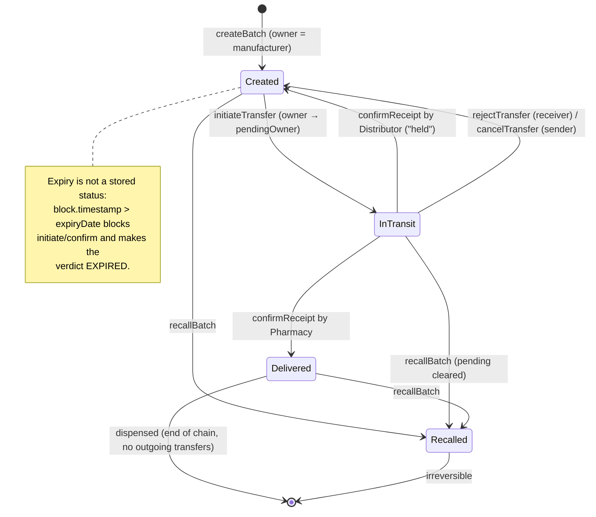
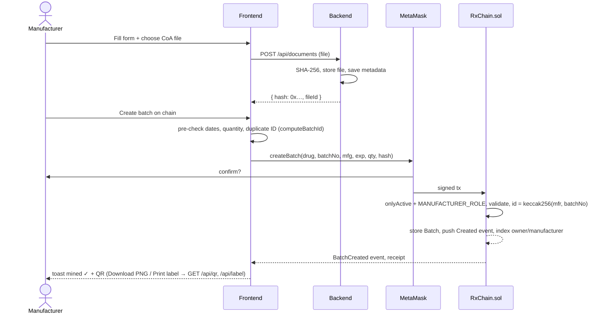
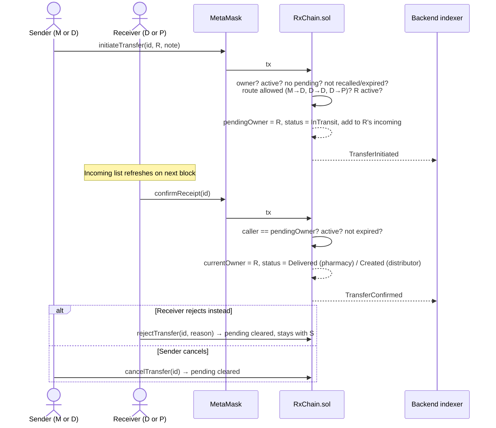
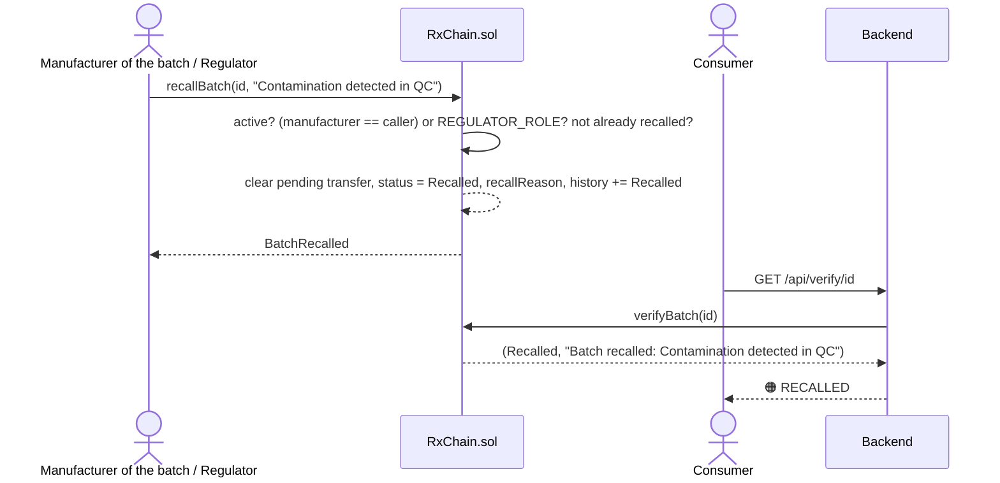
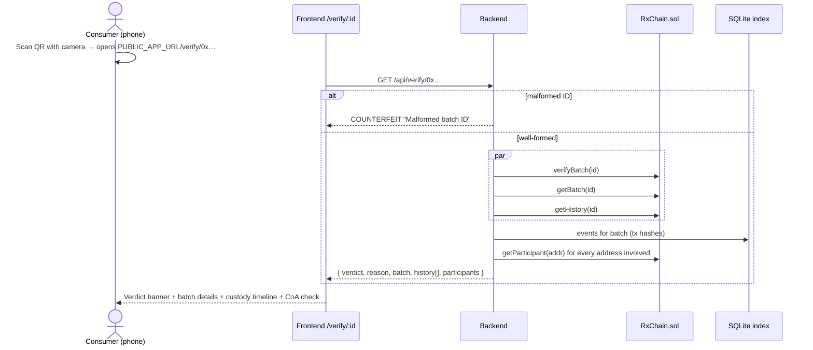
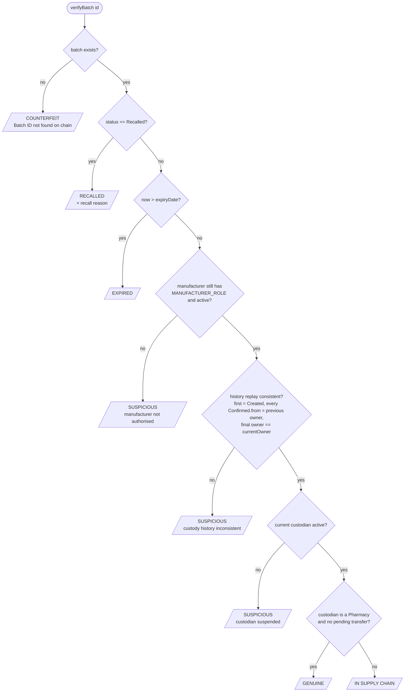

# RxChain Architecture

## 1. Components

| Component          | Responsibility                                                                                               | Trust                                                        |
| ------------------ | ------------------------------------------------------------------------------------------------------------ | ------------------------------------------------------------ |
| `RxChain.sol`      | Source of truth: participant registry, roles, batch records, custody history, verdict logic                  | Trustless: enforced by consensus                             |
| MetaMask           | Holds each participant's key, signs every write                                                              | Participant-controlled                                       |
| Frontend (React)   | Dashboards (read straight from the contract via JSON-RPC, write via MetaMask); public verifier (via backend) | Untrusted UI: the contract re-checks everything              |
| Backend (Express)  | Read-only chain access, verdict enrichment, QR/label rendering, document store, event index                  | Convenience layer: never signs, can be re-derived from chain |
| SQLite             | Event index (rebuildable from chain) + document metadata                                                     | Off-chain cache                                              |
| `backend/uploads/` | The CoA documents themselves                                                                                 | Off-chain; integrity proven by the on-chain hash             |

## 2. On-chain vs off-chain split

| Data                                                                    | Where                                | Why                                                                                                                                                      |
| ----------------------------------------------------------------------- | ------------------------------------ | -------------------------------------------------------------------------------------------------------------------------------------------------------- |
| Participant identity, role, licence ID, active flag                     | **On chain**                         | Authorisation must be enforced by the contract; anyone can audit who is licensed                                                                         |
| Batch identity, drug, batch no., dates, quantity, manufacturer          | **On chain**                         | This is what a consumer verifies; it must be tamper-proof                                                                                                |
| Custody history (every initiate/confirm/reject/cancel/recall/doc event) | **On chain** (struct array + events) | The chain of custody _is_ the anti-counterfeit evidence; `verifyBatch` replays it                                                                        |
| Verdict logic                                                           | **On chain** (`verifyBatch` view)    | Every client (web, mobile, third parties) gets the same answer from the same code: no backend to trust                                                   |
| Certificate of analysis (PDF/image)                                     | **Off chain** (disk)                 | Files are large: storing 100 KB on chain costs tens of millions of gas. They may also hold commercially sensitive data that should not be public forever |
| SHA-256 of the CoA                                                      | **On chain** (`docHash`, `bytes32`)  | 32 bytes are cheap and enough to prove integrity: altering one byte changes the hash, so `POST /api/documents/verify` detects tampering                  |
| QR images, printable labels                                             | **Off chain** (rendered on demand)   | Derived data: the QR only encodes `/verify/<batchId>`                                                                                                    |
| Activity feed / event index                                             | **Off chain** (SQLite)               | Scanning logs on every page load is slow; the index is a cache rebuilt from `queryFilter` and verified with block hashes                                 |

**Hash-only document storage** gives integrity without bloating the chain: the chain stores the commitment, the file can live anywhere (local disk here; IPFS or S3 in production), and anyone holding the file can check it.

## 3. Batch status state machine

## 4. Sequence diagrams

### 4.1 Create batch

### 4.2 Transfer + confirm

### 4.3 Recall

### 4.4 Consumer verify

## 5. Verdict decision flowchart

The order matters: a recalled batch reads **RECALLED** even after expiry, and safety signals (recall, expiry) win over authenticity signals.

## 6. Backend internals

- **ChainService:** a read-only `JsonRpcProvider` + `Contract` built from `src/contracts/RxChain.json`. It watches that file and hot-reloads after a redeploy. RPC failures map to `503`.
- **EventIndexer:** on start and then every `INDEXER_POLL_MS` it compares the head block with its cursor and pulls `contract.queryFilter("*", from, to)` in 2 000-block chunks. It stores each event with its block timestamp, tx hash and involved addresses. It re-indexes from the deploy block when the deployment key (`chainId:address:deployedAt`) changes, **or** when the stored block hash at the cursor no longer matches the chain (Hardhat restart or reorg). Without that check a restarted Hardhat node, which reuses the same deterministic contract address, would serve stale events.
- **Tx hashes in the timeline:** each on-chain `CustodyEvent` emits exactly one contract event, so history entry _i_ maps to the batch's _i_-th indexed log. The type is checked before the hash is attached.
- **DocumentStore:** files are written as `uploads/<sha256><ext>` (content-addressed, so uploads are idempotent) with metadata in SQLite. The demo CoA PDFs in `samples/` are imported at startup so seeded document links resolve.

## 7. Design decisions

Decisions not fixed by the brief, chosen to be most correct for a real pharma supply chain:

| #   | Decision                                                                                                                                                                               | Rationale                                                                                                                                                                                                       |
| --- | -------------------------------------------------------------------------------------------------------------------------------------------------------------------------------------- | --------------------------------------------------------------------------------------------------------------------------------------------------------------------------------------------------------------- |
| 1   | **Two-step transfers** (initiate → confirm) with reject and cancel                                                                                                                     | Custody must not move without the receiver acknowledging physical receipt (mirrors a goods-received note). Prevents dumping stock on someone                                                                    |
| 2   | **"Active" = registered ∧ not suspended ∧ still holds its AccessControl role**                                                                                                         | Suspension (`setParticipantActive`) and raw `revokeRole` both disable a participant, so admins cannot leave a half-revoked account able to act                                                                  |
| 3   | **Suspended participants cannot do anything** (create, initiate, confirm, reject, cancel, recall, attach)                                                                              | Suspension is the key-compromise response; a stolen key should not even be able to recall (a recall is irreversible, so a malicious one is a denial of service). The regulator can still recall on their behalf |
| 4   | **Deployer is registered as a Regulator participant** (constructor takes name, licence, location)                                                                                      | The admin appears in the participant list and custody timelines like everyone else; `REGULATOR_ROLE` is granted through the same code path                                                                      |
| 5   | **Regulator role can be granted to more accounts** via `registerParticipant(..., Regulator)`                                                                                           | State drug controllers can recall without holding the admin key                                                                                                                                                 |
| 6   | **Manufacturing date may be at most 1 day ahead of block time**                                                                                                                        | A batch cannot be manufactured in the future; the tolerance absorbs timezone/clock skew from date pickers (local midnight)                                                                                      |
| 7   | **Expired batches cannot be initiated or confirmed, but can be rejected/cancelled**                                                                                                    | Nobody should take custody of expired stock; the receiver must still be able to bounce it back                                                                                                                  |
| 8   | **Recall clears a pending transfer**                                                                                                                                                   | A recalled consignment should not be confirmable mid-transit                                                                                                                                                    |
| 9   | **Recall is allowed while delivered at a pharmacy**                                                                                                                                    | Recalls happen after distribution; the consumer verdict is what matters                                                                                                                                         |
| 10  | **Recall is subject to `pause`** (as the brief requires: all batch writes)                                                                                                             | The admin can unpause → recall → pause. Exempting recall was considered and documented as an option                                                                                                             |
| 11  | **Extra verdict rule: current custodian suspended → SUSPICIOUS**                                                                                                                       | Otherwise a pharmacy whose licence was suspended would make its stock read IN SUPPLY CHAIN, which is misleading                                                                                                 |
| 12  | **History-integrity replay in `verifyBatch`** is defence in depth                                                                                                                      | The contract cannot produce an inconsistent history today, but the check guards against future upgrades/migrations; it is tested through a harness contract                                                     |
| 13  | **O(1) owner and incoming indexes** (swap-and-pop sets with index maps)                                                                                                                | `getBatchesByOwner` and `getPendingIncoming` stay cheap to read as stock moves; manufacturer index is append-only (permanent provenance)                                                                        |
| 14  | **`computeBatchId`, `getAllBatchIds`, `isActiveParticipant` views added**                                                                                                              | The frontend can pre-check duplicates and the admin can list all batches without an indexer                                                                                                                     |
| 15  | **OpenZeppelin 5.1 pinned + `evmVersion: paris`**                                                                                                                                      | OZ ≥ 5.2 uses the `mcopy` opcode (Cancun). Paris bytecode runs on Hardhat **and** Ganache 7 as required                                                                                                         |
| 16  | **QR encodes a URL, not the raw ID**                                                                                                                                                   | Phone cameras open it directly; the verify page also accepts raw IDs or full URLs                                                                                                                               |
| 17  | **QR/label endpoints refuse unknown batch IDs (404)**                                                                                                                                  | The official API does not mint authentic-looking labels for codes that do not exist                                                                                                                             |
| 18  | **Malformed/unknown IDs are a COUNTERFEIT verdict (200), chain outages are 503**                                                                                                       | A consumer must never see "genuine" or a crash; an infrastructure error must not be shown as "counterfeit" either                                                                                               |
| 19  | **Frontend reads dashboards straight from the contract; backend only for verify/stats/feed/docs**                                                                                      | Dashboards work even if the backend is down; the verify page falls back to direct contract reads in the batch drawer                                                                                            |
| 20  | **Generated deployment files:** frontend gets `{address, chainId, abi}` (committed; deterministic on a fresh Hardhat node), backend also gets `deployBlock`, `deployedAt` (gitignored) | `npm test`/`npm run build` work on a fresh clone, and redeploys do not dirty git                                                                                                                                |
| 21  | **Live refresh on every new block** (2 s block-number poll)                                                                                                                            | Distributors see incoming consignments and pharmacies see verdict changes (e.g. a recall) without reloading                                                                                                     |
| 22  | **Built-in `/tx/:hash` viewer** (decodes the call and events)                                                                                                                          | Local chains have no Etherscan; set `VITE_EXPLORER_URL` to link to a real explorer instead                                                                                                                      |
| 23  | **Notes, reasons and names are stored as strings on chain**                                                                                                                            | Auditable without the backend; the UI caps lengths (notes 140, reasons 200 characters) to bound gas                                                                                                             |
