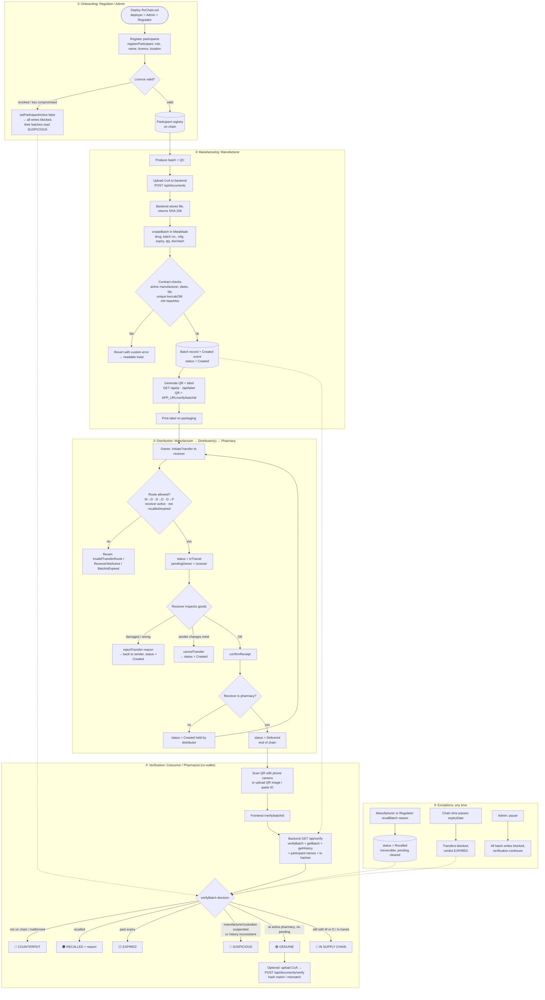

# RxChain System Workflow

This diagram fills **Section 6 (System Workflow)** of the project synopsis. It shows the complete life of a drug batch from onboarding to the consumer's verdict, with the component responsible for each step.

## Step-by-step

| Step | Actor                  | Action                              | On-chain effect                         | Off-chain effect                              |
| ---- | ---------------------- | ----------------------------------- | --------------------------------------- | --------------------------------------------- |
| 1    | Admin                  | Deploy contract                     | Admin + Regulator roles, registry entry | ABI/address written to frontend & backend     |
| 2    | Admin                  | Register each organisation          | `ParticipantRegistered`, role granted   | Indexed into activity feed                    |
| 3    | Manufacturer           | Upload CoA                          | none                                    | File stored, SHA-256 returned                 |
| 4    | Manufacturer           | `createBatch`                       | Batch + `Created` history entry         | QR/label rendered on demand                   |
| 5    | Sender                 | `initiateTransfer`                  | `InTransit`, pending owner              | Receiver's dashboard shows incoming           |
| 6    | Receiver               | `confirmReceipt` / `rejectTransfer` | Custody moves / returns                 | Timeline updated                              |
| 7    | Distributor            | Forward (repeat 5–6)                | D→D or D→P                              |                                               |
| 8    | Pharmacy               | `confirmReceipt`                    | `Delivered` → verdict GENUINE           | Inventory shows "OK to dispense"              |
| 9    | Manufacturer/Regulator | `recallBatch` (if needed)           | `Recalled`, irreversible                | Every scan shows RECALLED                     |
| 10   | Consumer               | Scan QR                             | `verifyBatch` (view, free)              | Verdict banner + custody timeline + CoA check |
