# RxChain: Complete Project Walkthrough

This document explains **every part of RxChain**: the problem it solves, the ideas behind it, the smart contract line by line, the backend, the frontend, the scripts, the tests and how it is deployed. Read it top to bottom to understand the whole system, or jump to the section you need.

> **Companion docs:** [`../README.md`](../README.md) (quick start and reference) · [`ARCHITECTURE.md`](ARCHITECTURE.md) (design decisions) · [`SECURITY.md`](SECURITY.md) (threat model) · [`SYSTEM_WORKFLOW.md`](SYSTEM_WORKFLOW.md) (synopsis workflow diagram)

---

## Table of contents

1. [The problem and why blockchain](#1-the-problem-and-why-blockchain)
2. [The big picture](#2-the-big-picture)
3. [Core concepts](#3-core-concepts)
4. [The smart contract (`RxChain.sol`)](#4-the-smart-contract-rxchainsol)
5. [Contract tooling and scripts](#5-contract-tooling-and-scripts)
6. [The backend (Express API)](#6-the-backend-express-api)
7. [The frontend (React app)](#7-the-frontend-react-app)
8. [End-to-end: one batch, every layer](#8-end-to-end-one-batch-every-layer)
9. [Where every piece of data lives](#9-where-every-piece-of-data-lives)
10. [Security in brief](#10-security-in-brief)
11. [Testing](#11-testing)
12. [Running and deployment](#12-running-and-deployment)
13. [Configuration reference](#13-configuration-reference)
14. [Extending the project](#14-extending-the-project)
15. [Glossary](#15-glossary)
16. [FAQ](#16-faq)

---

## 1. The problem and why blockchain

### 1.1 The problem

Counterfeit and substandard medicines are a serious public-health problem. A fake pack can look identical to a real one, and in a normal supply chain each company keeps its own private records. Nobody, least of all the patient at the pharmacy counter, can independently check:

- **Was this batch really made by the manufacturer on the label?**
- **Did it travel through licensed distributors, or was it diverted?**
- **Has it been recalled or has it expired?**
- **Is the quality certificate that came with it the original?**

### 1.2 What RxChain does

RxChain gives every drug batch a **digital identity on a blockchain** and records every hand-off between licensed parties. A QR code on the pack points to that record, so anyone with a phone camera can see a verdict (GENUINE, COUNTERFEIT, SUSPICIOUS, RECALLED, EXPIRED or IN SUPPLY CHAIN) along with the full custody history.

### 1.3 Why a blockchain and not a normal database?

| Requirement                                                             | Normal central database                                       | Blockchain (RxChain)                                                 |
| ----------------------------------------------------------------------- | ------------------------------------------------------------- | -------------------------------------------------------------------- |
| Records cannot be quietly edited or deleted                             | The DB admin can change anything                              | History is append-only contract storage; no function edits it        |
| Many competing companies write to the same ledger                       | Someone has to own and run it, and everyone has to trust them | Shared ledger; each party signs its own writes with its own key      |
| Rules (who can transfer to whom) are enforced the same way for everyone | Enforced by application code that the operator controls       | Enforced by the smart contract and consensus; nobody can bypass them |
| Anyone can audit                                                        | Only if the operator exposes an API                           | Anyone can call `verifyBatch` or read the events directly            |
| Non-repudiation (who did what)                                          | Logs, which the operator can alter                            | Every write is a transaction signed by the participant's private key |

The blockchain is used only for what needs these properties. Large files, images and caches stay off chain (see [§9](#9-where-every-piece-of-data-lives)).

---

## 2. The big picture

### 2.1 Components

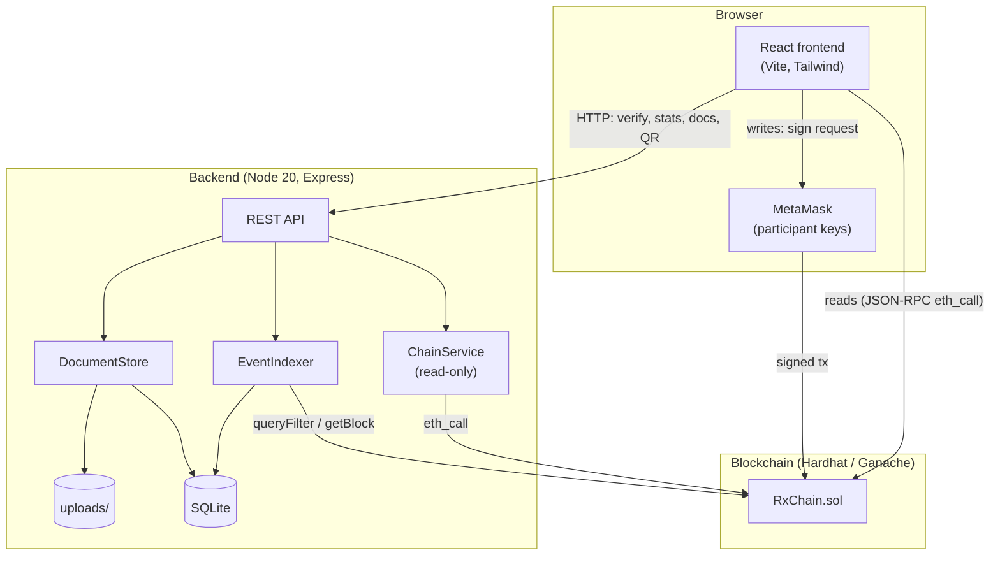

There are three running processes plus the wallet:

| Process      | Default port | Started by                | Purpose                                                           |
| ------------ | ------------ | ------------------------- | ----------------------------------------------------------------- |
| Hardhat node | `8545`       | `npm run chain`           | Local Ethereum chain (chainId 31337) with 20 funded test accounts |
| Backend      | `4000`       | `npm run dev -w backend`  | Read-only API, QR/labels, document store, event index             |
| Frontend     | `5173`       | `npm run dev -w frontend` | Public verifier + role dashboards                                 |
| MetaMask     | n/a          | Browser extension         | Holds participant keys, signs transactions                        |

**Key principle:** the backend **never holds a private key and never sends a transaction.** All writes are signed by participants in MetaMask. If the backend vanished, the contract and the dashboards would still work; only the conveniences (QR images, documents, the activity feed, the friendly verify payload) would go away.

### 2.2 Repository layout

```
RxChain/
├── package.json             npm workspaces (contracts, backend, frontend) + root scripts
├── scripts/demo.mjs         one-command orchestrator: chain → deploy → seed → dev
├── Dockerfile               one image used by every compose service
├── docker-compose.yml       chain, deployer, backend, frontend
├── samples/                 CoA-PCM-24001.pdf (genuine) and a TAMPERED copy
├── docs/                    this walkthrough, architecture, security, workflow, screenshots
│
├── contracts/               ── Hardhat workspace ──
│   ├── contracts/RxChain.sol            the smart contract
│   ├── contracts/test/RxChainHarness.sol  test-only subclass that corrupts history
│   ├── hardhat.config.ts                compiler, networks, gas reporter
│   ├── scripts/lib.ts                   shared helpers (deployment paths, enums, keys)
│   ├── scripts/deploy.ts                deploys and writes the ABI/address files
│   ├── scripts/seed.ts                  6 participants + 6 demo batches
│   ├── scripts/expire.ts                time-travel so one batch expires
│   ├── scripts/e2e.ts                   scripted end-to-end flow
│   └── test/RxChain.test.ts             56 Mocha/Chai tests
│
├── backend/                 ── Express API ──
│   ├── src/index.ts         entry point (boot sequence)
│   ├── src/config.ts        env parsing with zod
│   ├── src/context.ts       wires services together
│   ├── src/app.ts           Express app, middleware, routers
│   ├── src/types.ts         enum names + DTO types
│   ├── src/lib/             asyncHandler, HttpError, validation regexes, AppContext type
│   ├── src/middleware/      404 + central error handler
│   ├── src/routes/          health, verify, qr, label, documents, stats, events
│   ├── src/services/        chain, indexer, eventStore, documents, db
│   └── test/                Jest globalSetup (real Hardhat node) + api.test.ts
│
└── frontend/                ── React app ──
    ├── src/main.tsx, App.tsx     entry + routes + providers
    ├── src/contracts/RxChain.json  {address, chainId, abi} written by deploy
    ├── src/lib/                  config, contract reads, API client, error decoding, formatting
    ├── src/hooks/                wallet, tx, live block tick, directory, async, batches
    ├── src/components/           UI building blocks (timeline, modals, QR, scanner…)
    └── src/pages/                Landing, Verify, dashboards, BatchDetail, TxDetail
```

---

## 3. Core concepts

Understand these eight ideas and the rest of the code follows naturally.

### 3.1 Participants and roles

Every organisation is a **participant**: a wallet address plus a role, name, licence ID and location, stored on chain. There are four roles:

| Role         | Real-world equivalent                         | Key powers                                                    |
| ------------ | --------------------------------------------- | ------------------------------------------------------------- |
| Regulator    | State or central drug controller              | Recall any batch (the admin also registers, suspends, pauses) |
| Manufacturer | Pharma company with a manufacturing licence   | Create batches, attach CoAs, recall own batches               |
| Distributor  | Licensed wholesaler (WDL)                     | Receive from M or D, forward to D or P                        |
| Pharmacy     | Licensed retailer (RDL): the dispensing point | Receive; cannot transfer further                              |

The **admin** is the account that deployed the contract. It holds OpenZeppelin's `DEFAULT_ADMIN_ROLE` and is also registered as a Regulator participant.

### 3.2 "Active"

A participant can act only if it is **active**, which the contract defines as all three of:

1. registered (role ≠ None),
2. not suspended (`active == true`), and
3. still holding its AccessControl role (it was not revoked with `revokeRole`).

This means an admin cannot accidentally leave a half-revoked account able to act.

### 3.3 Batch and batch ID

A **batch** is one production lot of a drug: drug name, batch number, manufacturing and expiry dates, quantity, manufacturer, current owner, status, and an optional document hash.

Its ID is deterministic:

```
batchId = keccak256(abi.encodePacked(manufacturerAddress, batchNumber))
```

This has three useful effects:

- The same manufacturer cannot create the same batch number twice (`BatchAlreadyExists`).
- Two manufacturers can both use batch number `B-001` without clashing, because the address is part of the ID.
- The frontend can compute the ID **before** sending the transaction (`computeBatchId`) to catch duplicates early, and the seeded demo IDs are the same on every fresh chain.

### 3.4 Custody and two-step transfers

The **current owner** is whoever physically holds the batch. Ownership moves in two steps:

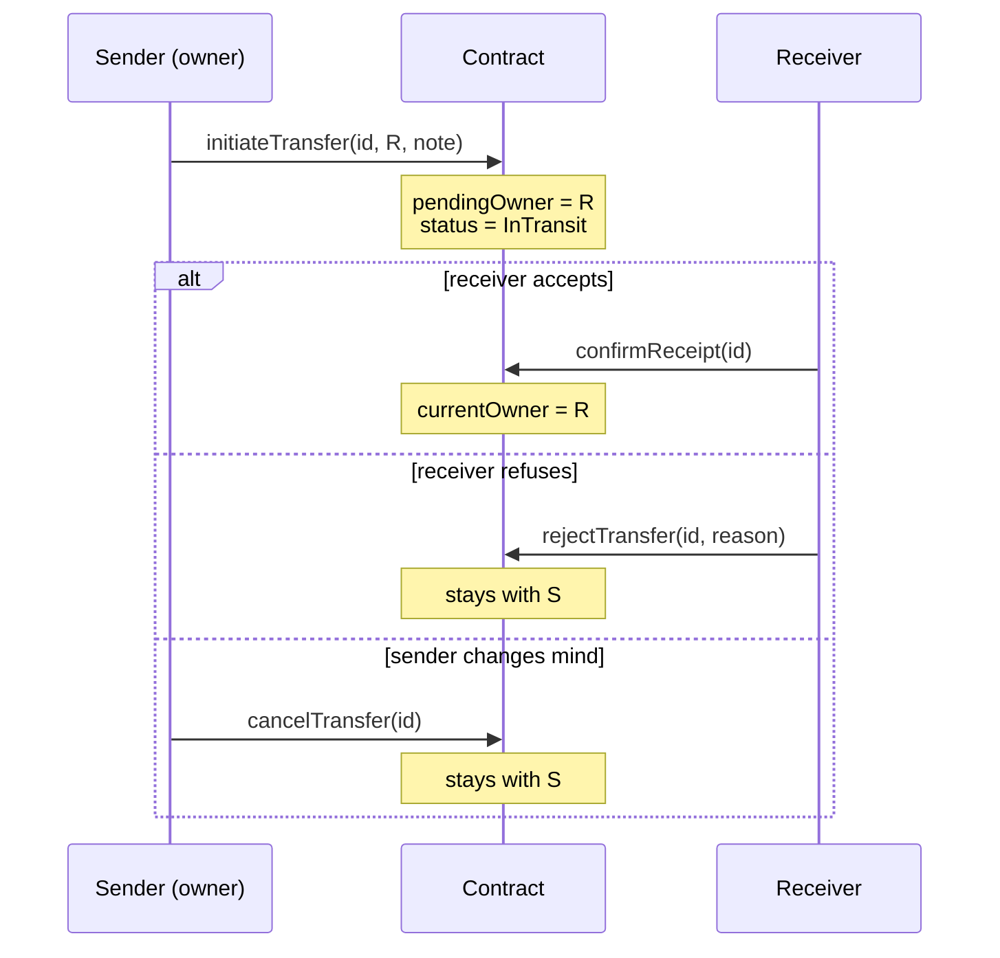

Custody never moves without the receiver's own signature. This mirrors a goods-received note in a real warehouse and stops anyone "dumping" stock on another party.

### 3.5 Transfer routes

Only three routes are legal: **Manufacturer → Distributor**, **Distributor → Distributor**, **Distributor → Pharmacy**. A manufacturer cannot ship straight to a pharmacy (bypassing licensed wholesale), and a pharmacy cannot send stock back into the chain (diversion). Anything else reverts with `InvalidTransferRoute(fromRole, toRole)`.

### 3.6 Custody history

Every action on a batch appends a `CustodyEvent {from, to, eventType, timestamp, note}` to that batch's history array. Nothing ever edits or removes entries. The seven event types are `Created`, `TransferInitiated`, `TransferConfirmed`, `TransferCancelled`, `TransferRejected`, `Recalled` and `DocumentAttached`.

### 3.7 The verdict

`verifyBatch(id)` is a free `view` function that turns the batch record and its history into one of six verdicts. It is the heart of the anti-counterfeiting logic and is explained in detail in [§4.8](#48-verifybatch-the-anti-counterfeit-logic).

### 3.8 Document hash (CoA)

A **Certificate of Analysis** (the lab report proving a batch passed quality control) is too big to store on chain. Instead, the file is stored off chain and only its **SHA-256 fingerprint** (32 bytes) is stored on chain as `docHash`. Anyone holding the file can recompute the hash; if even one byte has changed, the hashes will not match.

---

## 4. The smart contract (`RxChain.sol`)

File: `contracts/contracts/RxChain.sol`. Solidity `^0.8.24`, about 700 lines including NatSpec comments.

### 4.1 Inheritance

```solidity
contract RxChain is AccessControl, Pausable
```

- **`AccessControl`** (OpenZeppelin 5.1) provides role-based permissions: `hasRole`, `grantRole`, `revokeRole`, the `onlyRole` modifier and the `AccessControlUnauthorizedAccount` error.
- **`Pausable`** provides `whenNotPaused`, `_pause`, `_unpause` and the `EnforcedPause` error, which serve as an emergency stop.
- **`Strings`** is used once, to turn a `bytes32` document hash into a hex string for the history note.

OpenZeppelin is **pinned to 5.1.0** because 5.2+ uses the `mcopy` opcode (Cancun hardfork), and the project compiles for the `paris` EVM so the same bytecode runs on Ganache 7.

### 4.2 Roles

```solidity
bytes32 public constant REGULATOR_ROLE    = keccak256("REGULATOR_ROLE");
bytes32 public constant MANUFACTURER_ROLE = keccak256("MANUFACTURER_ROLE");
bytes32 public constant DISTRIBUTOR_ROLE  = keccak256("DISTRIBUTOR_ROLE");
bytes32 public constant PHARMACY_ROLE     = keccak256("PHARMACY_ROLE");
```

Plus `DEFAULT_ADMIN_ROLE` (`0x00…00`) from OpenZeppelin. A participant's `Role` enum value is mapped to these hashes by `_roleHash()`.

### 4.3 Types

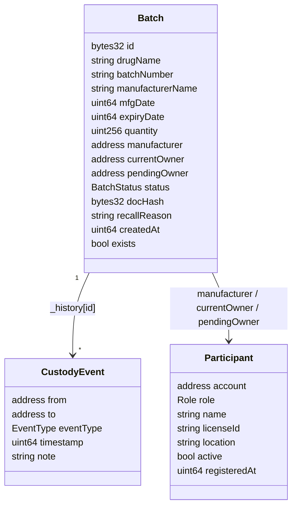

Enums:

| Enum          | Values                                                                                                                       |
| ------------- | ---------------------------------------------------------------------------------------------------------------------------- |
| `Role`        | `None`, `Manufacturer`, `Distributor`, `Pharmacy`, `Regulator`                                                               |
| `BatchStatus` | `Created` (held by someone), `InTransit` (pending transfer), `Delivered` (at a pharmacy), `Recalled`                         |
| `EventType`   | `Created`, `TransferInitiated`, `TransferConfirmed`, `TransferCancelled`, `TransferRejected`, `Recalled`, `DocumentAttached` |
| `Verdict`     | `Genuine`, `Counterfeit`, `Suspicious`, `Recalled`, `Expired`, `InSupplyChain`                                               |

Notes:

- `manufacturerName` is **copied from the registry** at creation time, never taken from user input, so a manufacturer cannot claim to be someone else.
- `exists` distinguishes "no batch" from a zero-filled struct (Solidity mappings return zeros for unknown keys).
- **Expiry is not a status.** It is derived on the fly by comparing `block.timestamp` to `expiryDate`, so no transaction is needed for a batch to "become" expired.

### 4.4 Storage layout

| Variable                       | Type                                    | Purpose                                               |
| ------------------------------ | --------------------------------------- | ----------------------------------------------------- |
| `_participants`                | `mapping(address => Participant)`       | Registry lookup                                       |
| `_participantList`             | `address[]`                             | Registration order, for `getAllParticipants`          |
| `_batches`                     | `mapping(bytes32 => Batch)`             | Batch records                                         |
| `_batchIds`                    | `bytes32[]`                             | Creation order, for `getAllBatchIds` / `totalBatches` |
| `_history`                     | `mapping(bytes32 => CustodyEvent[])`    | Append-only custody log per batch                     |
| `_byManufacturer`              | `mapping(address => bytes32[])`         | Every batch a manufacturer ever made (append-only)    |
| `_owned` / `_ownedIndex`       | set: `address => bytes32[]` + index map | Batches an address currently holds                    |
| `_incoming` / `_incomingIndex` | set: `address => bytes32[]` + index map | Batches waiting for an address to confirm             |
| `MFG_DATE_TOLERANCE`           | `uint64 constant = 1 days`              | Clock-skew allowance for the manufacturing date       |

**Swap-and-pop sets.** `_owned` and `_incoming` must support fast add and remove as stock moves. Each is an array plus an index map that stores _position + 1_ (so 0 means "not present"). To remove an element, `_removeFromSet` moves the last element into the hole and pops the array: O(1), no loops, no gaps.

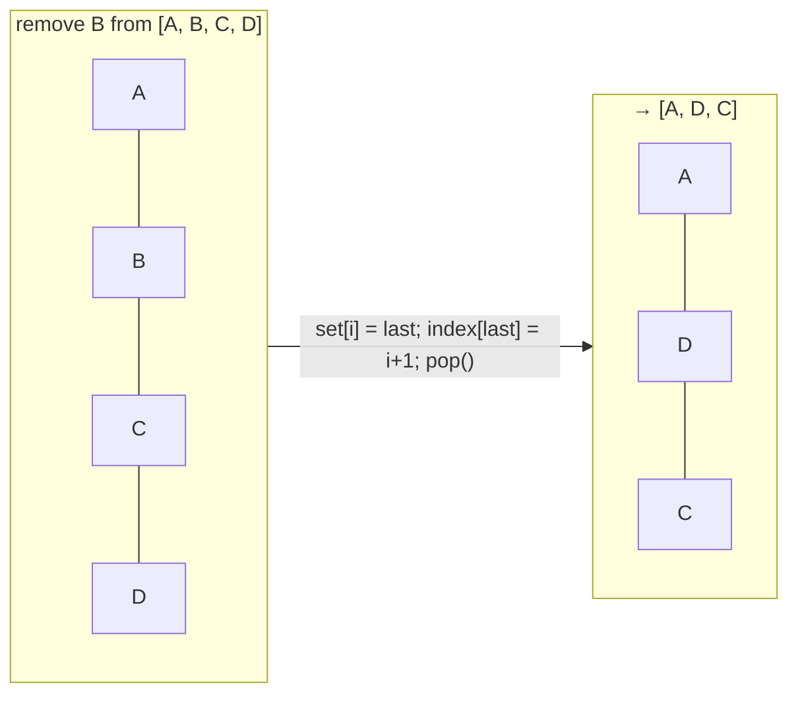

### 4.5 Modifiers

| Modifier          | Source       | Check                   | Error                              |
| ----------------- | ------------ | ----------------------- | ---------------------------------- |
| `onlyRole(role)`  | OpenZeppelin | Caller holds the role   | `AccessControlUnauthorizedAccount` |
| `whenNotPaused`   | OpenZeppelin | Contract is not paused  | `EnforcedPause`                    |
| `onlyActive`      | RxChain      | `_isActive(msg.sender)` | `NotActiveParticipant`             |
| `batchExists(id)` | RxChain      | `_batches[id].exists`   | `BatchNotFound`                    |

### 4.6 Admin functions

**`constructor(regulatorName, regulatorLicenseId, regulatorLocation)`**
Grants the deployer `DEFAULT_ADMIN_ROLE` and registers it as a Regulator through the same `_register` path used for everyone else, so the admin shows up in participant lists and timelines.

**`registerParticipant(account, role, name, licenseId, location)`**, admin only.
`_register` validates: non-zero address (`ZeroAddress`), role ≠ None (`InvalidRole`), non-empty name and licence (`EmptyField`), not already registered (`AlreadyRegistered`). It stores the participant as active, appends to `_participantList`, grants the matching AccessControl role and emits `ParticipantRegistered`. Registering another account as **Regulator** gives it recall power without the admin key.

**`setParticipantActive(account, active)`**, admin only.
Suspends or reactivates a participant (`NotRegistered` if unknown) and emits `ParticipantStatusChanged`. Suspension is the response to key compromise or a revoked licence: a suspended account can do nothing, and batches it manufactured or holds verify as SUSPICIOUS.

**`pause()` / `unpause()`**, admin only.
Freezes every batch-changing function (create, transfer, confirm, reject, cancel, recall, attach). Views, including `verifyBatch`, keep working.

### 4.7 Batch lifecycle functions

Each function below lists its checks **in the order the contract performs them**. The order determines which error you see when several things are wrong.

#### `createBatch(drugName, batchNumber, mfgDate, expiryDate, quantity, docHash) → id`

Modifiers: `whenNotPaused`, `onlyActive`.

1. Caller has `MANUFACTURER_ROLE` → else `AccessControlUnauthorizedAccount`.
2. `drugName` and `batchNumber` are non-empty → else `EmptyField`.
3. Dates: `expiryDate > mfgDate`, `expiryDate > now`, `mfgDate ≤ now + 1 day` → else `InvalidDates`.
4. `quantity > 0` → else `InvalidQuantity`.
5. `id = keccak256(msg.sender, batchNumber)` is unused → else `BatchAlreadyExists`.

Effects: writes the `Batch` (owner = manufacturer, status `Created`), pushes to `_batchIds` and `_byManufacturer`, adds to the owner set, logs a `Created` history entry with note "Batch manufactured", and emits `BatchCreated`. `docHash` may be zero (no CoA).

#### `initiateTransfer(id, to, note)`

Modifiers: `whenNotPaused`, `batchExists`, `onlyActive`.

1. Caller is `currentOwner` → `NotCurrentOwner`
2. Not recalled → `BatchIsRecalled`
3. No pending transfer → `TransferAlreadyPending`
4. Not expired → `BatchIsExpired`
5. `to ≠ 0` → `ZeroAddress`; `to ≠ caller` → `SelfTransfer`
6. Receiver active → `ReceiverNotActive`
7. Route is M→D, D→D or D→P → `InvalidTransferRoute(fromRole, toRole)`

Effects: `pendingOwner = to`, status `InTransit`, add to receiver's incoming set, log `TransferInitiated` with the note (an invoice or delivery challan number), emit `TransferInitiated`.

#### `confirmReceipt(id)`

1. There is a pending transfer → `NoPendingTransfer`
2. Caller is the pending owner → `NotPendingOwner`
3. Not expired → `BatchIsExpired` (nobody should take custody of expired stock)

Effects: remove from receiver's incoming set, move between owner sets, `currentOwner = caller`, clear `pendingOwner`, status becomes **`Delivered` if the receiver is a Pharmacy, otherwise `Created`** (held by a distributor). Logs `TransferConfirmed` and emits it.

#### `rejectTransfer(id, reason)`

Pending owner only. Clears the pending transfer, status back to `Created`, logs `TransferRejected` with the reason (e.g. "damaged in transit"). Allowed even after expiry, so the receiver can always bounce stock back.

#### `cancelTransfer(id)`

Current owner only, with a pending transfer. Clears it, status back to `Created`, logs `TransferCancelled`.

#### `recallBatch(id, reason)`

1. Caller is the batch's manufacturer **or** holds `REGULATOR_ROLE` → `NotAuthorizedToRecall`
2. Not already recalled → `BatchIsRecalled`
3. Reason non-empty → `EmptyField`

Effects: clears any pending transfer (a recalled consignment cannot be confirmed mid-transit), status `Recalled` (**irreversible**: there is no un-recall), stores `recallReason` (shown to consumers), logs and emits `BatchRecalled`. A recall is still subject to `onlyActive` and `whenNotPaused`. A suspended manufacturer therefore cannot maliciously recall, but a regulator can still recall on its behalf.

#### `attachDocument(id, docHash)`

Batch manufacturer only (`NotBatchManufacturer`), hash non-zero (`InvalidDocHash`). Sets or replaces `docHash` and logs `DocumentAttached` with the hash as hex in the note, so every replacement is auditable.

### 4.8 `verifyBatch`: the anti-counterfeit logic

```solidity
function verifyBatch(bytes32 id) external view returns (Verdict verdict, string memory reason)
```

The checks run in a fixed order and the **first match wins**:

| #   | Condition                                                | Verdict         | Reason text                                                                 |
| --- | -------------------------------------------------------- | --------------- | --------------------------------------------------------------------------- |
| 1   | Batch does not exist                                     | `Counterfeit`   | Batch ID not found on chain                                                 |
| 2   | Status is `Recalled`                                     | `Recalled`      | Batch recalled: _reason_                                                    |
| 3   | `block.timestamp > expiryDate`                           | `Expired`       | Batch is past its expiry date - do not consume                              |
| 4   | Manufacturer lost `MANUFACTURER_ROLE` or is suspended    | `Suspicious`    | Manufacturer is no longer an authorised, active participant                 |
| 5   | History replay inconsistent                              | `Suspicious`    | Custody history is inconsistent with the current owner                      |
| 6   | Current custodian is not active                          | `Suspicious`    | Current custodian is suspended or no longer authorised                      |
| 7   | Custodian is a Pharmacy and there is no pending transfer | `Genuine`       | Authentic batch with a complete custody chain ending at a licensed pharmacy |
| 8   | Otherwise                                                | `InSupplyChain` | Authentic batch, still moving through the supply chain                      |

**Why this order?** Safety signals first: a recalled or expired medicine must never read as anything reassuring. Then authenticity signals. Only a batch that passes every check _and_ sits at an active pharmacy is GENUINE.

**Why does IN SUPPLY CHAIN matter?** A QR copied from stock that is still at a distributor reads IN SUPPLY CHAIN. If someone offers you that pack on the street, the verdict itself is the red flag: genuine medicine reaches consumers through a pharmacy.

**History replay (`_historyIsConsistent`).** Walks the history from the start, tracking the expected owner:

- the first entry must be `Created` (and no later `Created` may appear); the owner becomes its `to`;
- every `TransferConfirmed` must have `from == current tracked owner`; the owner becomes its `to`;
- other event types don't change ownership;
- at the end, the tracked owner must be non-zero and equal `currentOwner`.

The production contract cannot produce an inconsistent history, so this is **defence in depth**: it guards against a future upgrade or migration bug. It is tested with `RxChainHarness.sol`, which deliberately corrupts history (see [§11](#11-testing)).

### 4.9 View functions

| Function                              | Returns                                     | Used by                                   |
| ------------------------------------- | ------------------------------------------- | ----------------------------------------- |
| `getParticipant(addr)`                | Participant struct (role `None` if unknown) | Wallet role detection, names everywhere   |
| `getAllParticipants()`                | All participants in registration order      | Directory, admin table, transfer dropdown |
| `isActiveParticipant(addr)`           | Active flag per [§3.2](#32-active)          | e2e script, external callers              |
| `getBatch(id)`                        | Batch struct (`exists = false` if unknown)  | Verify, drawers, dashboards               |
| `getHistory(id)`                      | Custody events, oldest first                | Timelines                                 |
| `getBatchesByOwner(addr)`             | IDs currently held                          | Distributor / pharmacy inventory          |
| `getBatchesByManufacturer(addr)`      | IDs ever created                            | Manufacturer "My batches"                 |
| `getPendingIncoming(addr)`            | IDs awaiting this address's confirmation    | Incoming panels                           |
| `getAllBatchIds()` / `totalBatches()` | Every batch                                 | Admin console, `/api/stats`               |
| `computeBatchId(mfr, batchNumber)`    | The deterministic ID (`pure`)               | Duplicate pre-check, scripts              |
| `verifyBatch(id)`                     | `(Verdict, reason)`                         | Everything that shows a verdict           |
| `paused()`, `hasRole()`               | OpenZeppelin views                          | Admin console, wallet admin detection     |

### 4.10 Events

Each history entry emits **exactly one** contract event. The backend relies on this 1:1 mapping to attach transaction hashes to timeline entries.

| Event                      | Indexed fields         | Emitted by             | History entry       |
| -------------------------- | ---------------------- | ---------------------- | ------------------- |
| `ParticipantRegistered`    | `account`              | `_register`            | none                |
| `ParticipantStatusChanged` | `account`              | `setParticipantActive` | none                |
| `BatchCreated`             | `id`, `manufacturer`   | `createBatch`          | `Created`           |
| `TransferInitiated`        | `id`, `from`, `to`     | `initiateTransfer`     | `TransferInitiated` |
| `TransferConfirmed`        | `id`, `from`, `to`     | `confirmReceipt`       | `TransferConfirmed` |
| `TransferRejected`         | `id`, `by`, `owner`    | `rejectTransfer`       | `TransferRejected`  |
| `TransferCancelled`        | `id`, `by`, `receiver` | `cancelTransfer`       | `TransferCancelled` |
| `BatchRecalled`            | `id`, `by`             | `recallBatch`          | `Recalled`          |
| `DocumentAttached`         | `id`, `by`             | `attachDocument`       | `DocumentAttached`  |

OpenZeppelin also emits `RoleGranted`, `RoleRevoked`, `Paused` and `Unpaused`.

### 4.11 Custom errors

Custom errors (`error BatchIsRecalled(bytes32 id);`) are cheaper than revert strings and carry typed arguments. The frontend decodes every one of them into a sentence (see [§7.4](#74-libraries-srclib)). The full list is in the [README](../README.md#-smart-contract-reference).

### 4.12 Things the contract deliberately does **not** do

- **No ETH handling.** No function is `payable`, nothing is sent, and there are no external calls to untrusted contracts, so there is no reentrancy surface.
- **No upgradeability.** The contract is immutable once deployed (an upgrade would be a new deployment plus migration).
- **No deletion or editing** of batches or history.

---

## 5. Contract tooling and scripts

### 5.1 `hardhat.config.ts`

| Setting             | Value                                           | Why                                           |
| ------------------- | ----------------------------------------------- | --------------------------------------------- |
| Solidity            | `0.8.24`, optimizer 200 runs                    | Modern compiler with built-in overflow checks |
| `evmVersion`        | `paris`                                         | Runs on Hardhat **and** Ganache 7             |
| `hardhat` network   | chainId 31337                                   | In-process network used by `hardhat test`     |
| `localhost` network | `RPC_URL` or `127.0.0.1:8545`                   | The standalone `hardhat node`                 |
| `ganache` network   | `GANACHE_URL` or `127.0.0.1:7545`, chainId 1337 | Alternative local chain                       |
| `gasReporter`       | enabled, optional output file                   | Produces the gas table in the README          |
| mocha timeout       | 120 s                                           |                                               |

### 5.2 `scripts/lib.ts`: shared helpers

- **Deployment file paths.** `FRONTEND_DEPLOYMENT_FILE` (default `frontend/src/contracts/RxChain.json`) and `BACKEND_DEPLOYMENT_FILE` (default `backend/src/contracts/RxChain.json`), overridable via `RXCHAIN_FRONTEND_FILE` / `RXCHAIN_BACKEND_FILE` (used by Docker).
- **Enum mirrors.** `Role`, `ROLE_NAMES`, `VERDICT_NAMES`, `STATUS_NAMES`.
- **`loadContract()`** reads the backend deployment file and refuses to continue if the chainId differs or no code exists at the address ("chain restarted? run npm run deploy").
- **`hardhatPrivateKey(i)`** derives the private key of Hardhat's default account _i_ from the mnemonic, used to print demo keys and by the e2e script.

### 5.3 `scripts/deploy.ts`

1. Deploys `RxChain` with the regulator's name, licence and location (`REGULATOR_NAME`, `REGULATOR_LICENSE`, `REGULATOR_LOCATION`, defaulting to "Central Drug Regulator", "REG-IN-0001", "New Delhi").
2. Writes **two** deployment files:

| File                                  | Contents                           | Git        | Why                                                                                    |
| ------------------------------------- | ---------------------------------- | ---------- | -------------------------------------------------------------------------------------- |
| `frontend/src/contracts/RxChain.json` | `{address, chainId, abi}`          | committed  | Imported at build time; deterministic on a fresh Hardhat node, so a fresh clone builds |
| `backend/src/contracts/RxChain.json`  | same + `deployBlock`, `deployedAt` | gitignored | The indexer needs the start block; the timestamp changes every deploy                  |

### 5.4 `scripts/seed.ts`

Idempotent: it skips participants and batches that already exist, so running it twice is safe.

**Participants** (Hardhat accounts 1–6):

| #   | Name                  | Role         | Licence          |
| --- | --------------------- | ------------ | ---------------- |
| 1   | Sun Pharma Ltd        | Manufacturer | MFG-MH-2011-0457 |
| 2   | Cipla Ltd             | Manufacturer | MFG-MH-1998-0112 |
| 3   | MedLine Distributors  | Distributor  | WDL-DL-2019-3381 |
| 4   | HealthKart Logistics  | Distributor  | WDL-HR-2020-0921 |
| 5   | Apollo Pharmacy Noida | Pharmacy     | RDL-UP-2018-7782 |
| 6   | City Care Chemist     | Pharmacy     | RDL-UP-2021-1290 |

**Batches**, each designed to demonstrate one scenario:

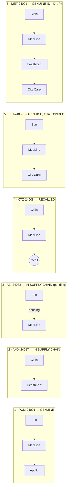

Batch 1 carries the SHA-256 of `samples/CoA-PCM-24001.pdf` as its `docHash`. Batch 5 expires 3 days after seeding (chain time), which `npm run expire` exploits. At the end the script prints the account table (with private keys on chainId 31337), the batch table with live verdicts, and ready-to-click verify links, including one for a random (counterfeit) ID.

### 5.5 `scripts/expire.ts`

Computes the ID of `IBU-24050` (override with `BATCH_NUMBER`), then calls `evm_increaseTime` to jump chain time to 60 s past its expiry and `evm_mine` to mine a block with the new timestamp. The verdict flips to EXPIRED with no transaction to the contract, which shows that expiry is derived and not stored.

> Time travel moves the **whole chain** forward. Other batches' expiry dates come closer too; a fresh `npm run demo` resets everything.

### 5.6 `scripts/e2e.ts`

A scripted acceptance test using real signed transactions from Hardhat's keys (wrapped in `NonceManager`):

1. register a new pharmacy (account #7) if missing
2. Sun Pharma creates `Pantoprazole 40mg` with batch number `E2E-<timestamp>` → asserts IN SUPPLY CHAIN
3. Sun → MedLine initiate → asserts pending
4. MedLine confirms → asserts owner
5. MedLine → pharmacy initiate
6. pharmacy confirms → asserts `Delivered`
7. asserts **Genuine** (and `GENUINE` via `GET /api/verify` if the backend is up)
8. regulator recalls
9. asserts **Recalled**, 6 history entries, and that the recalled batch can no longer move

---

## 6. The backend (Express API)

The backend is a **read-only convenience layer**. It makes verification fast and friendly, renders QR codes and labels, stores documents, and indexes events for activity feeds.

### 6.1 Boot sequence (`src/index.ts`)

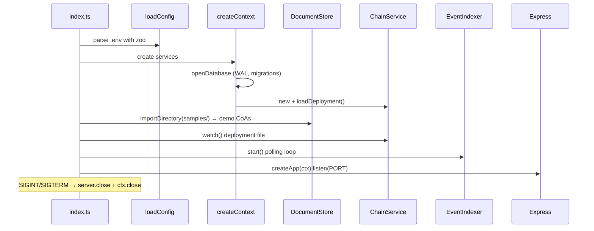

If the deployment file does not exist yet, the backend still starts and waits. `watch()` picks it up as soon as `npm run deploy` writes it, with no restart needed.

### 6.2 Configuration (`src/config.ts`)

Environment variables are validated with a zod schema. Empty strings are treated as unset so defaults apply. Relative paths resolve against the **backend package root**, not the current directory, so the backend behaves the same however it is launched. `CORS_ORIGIN` may be `*` or a comma-separated list. All variables are listed in [§13](#13-configuration-reference).

### 6.3 Wiring (`src/context.ts`)

`createContext(config)` builds the services and returns an `AppContext` `{config, chain, events, documents, indexer}` plus `close()`. Routes receive this context as a parameter (simple dependency injection), which is what lets the tests build an app against a temporary database and a test chain.

### 6.4 The Express app (`src/app.ts`)

Middleware, in order:

| Middleware         | Configuration                                                  | Purpose                                                                                    |
| ------------------ | -------------------------------------------------------------- | ------------------------------------------------------------------------------------------ |
| `x-powered-by` off |                                                                | Don't advertise Express                                                                    |
| `helmet`           | `crossOriginResourcePolicy: cross-origin`                      | Security headers; QR images and docs can still be embedded by the frontend on another port |
| `cors`             | origin from config; exposes `X-Verify-Url`, `X-Content-SHA256` | Frontend on :5173 calls API on :4000                                                       |
| `express.json`     | 100 kB limit                                                   |                                                                                            |
| `morgan('dev')`    | disabled in tests                                              | Request logging                                                                            |
| `/api` router      | health, verify, qr, label, documents, stats, events            |                                                                                            |
| `GET /`            | small JSON pointer to `/api/health`                            |                                                                                            |
| `notFoundHandler`  |                                                                | JSON 404                                                                                   |
| `errorHandler`     |                                                                | Central error mapping (below)                                                              |

**Error handling.** Routes are wrapped in `asyncHandler` so rejected promises reach the central handler, which maps:

| Error               | HTTP                              |
| ------------------- | --------------------------------- |
| `HttpError(status)` | that status                       |
| `ZodError`          | 400 "Validation failed" + details |
| `MulterError`       | 413 if file too large, else 400   |
| anything else       | 500 (logged)                      |

### 6.5 `ChainService` (`src/services/chain.ts`)

A read-only wrapper around an ethers v6 `JsonRpcProvider` and `Contract`.

- **`loadDeployment()`** reads the deployment JSON. It ignores a half-written file, detects changes by address, chainId or `deployedAt`, recreates the provider if the chain changed, and emits a `"deployment"` event.
- **`watch()`** uses `fs.watchFile` to hot-reload after a redeploy.
- **`call(fn, ...args)`** wraps every `staticCall` and maps failures to clear HTTP errors:
  - `ECONNREFUSED` / `NETWORK_ERROR` / `TIMEOUT` / "fetch failed" → **503 "Blockchain node unreachable"**
  - `BAD_DATA` / `CALL_EXCEPTION` → **503 "Contract not found at the configured address — redeploy?"**
- **DTO conversion** (`toBatch`, `toParticipant`): enums become names, `bigint` quantity becomes a string, the zero address becomes `null` for `pendingOwner`, and a zero hash becomes `null` for `docHash`.
- Helpers: `status()`, `chainTime()` (latest block timestamp, which matters after time travel), `verify`, `getBatch`, `getHistory`, `getParticipant`, `getAllParticipants`, `getAllBatches`, `isPaused`, `participantsFor(addresses)`.

### 6.6 `EventIndexer` (`src/services/indexer.ts`)

Scanning logs on every page load would be slow, so the indexer copies every RxChain event into SQLite.

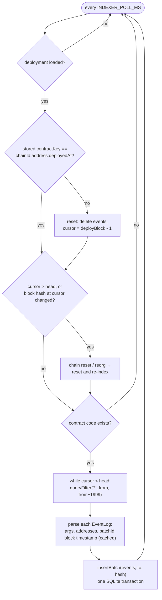

Key points:

- **Chunked backfill** in 2,000-block windows.
- **Cursor + block hash.** After each chunk the indexer stores the last block number _and its hash_. A restarted Hardhat node redeploys to the **same deterministic address**, so the address alone cannot detect a reset; the hash comparison can.
- **Atomic writes.** Events and the cursor are committed in one transaction, and `INSERT OR IGNORE` on `(tx_hash, log_index)` makes re-runs safe.
- **Single-flight.** Concurrent `sync()` calls share one in-flight pass.
- **Verdicts never depend on the index.** It only supplies tx hashes and activity feeds.

### 6.7 `EventStore` and the database (`src/services/eventStore.ts`, `db.ts`)

SQLite via `better-sqlite3` (synchronous and fast), WAL journal mode, schema created on open:

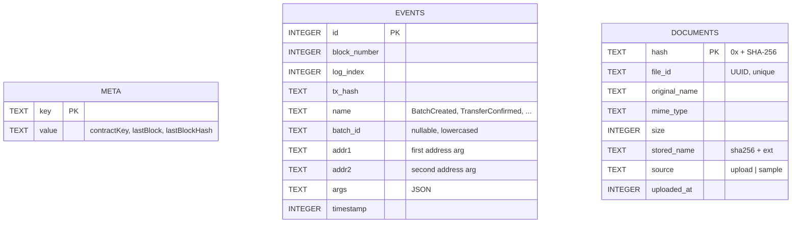

`events` is indexed on `batch_id`, `addr1`, `addr2` and `(block_number, log_index)`; `UNIQUE(tx_hash, log_index)` prevents duplicates. `EventStore.query()` filters by batch, address (either party), and event name, newest first, with a limit of 1–500. `forBatch()` returns one batch's events oldest first.

### 6.8 `DocumentStore` (`src/services/documents.ts`)

- `sha256Hex(buffer)` → `0x` + 64 hex: exactly the `bytes32` that goes on chain.
- `save()` is **content-addressed**: the file is written as `uploads/<sha256><ext>`, so uploading the same file twice is idempotent. Filenames never come from user input; the extension is sanitised and truncated.
- `importDirectory(samples/)` loads the demo CoA PDFs at boot so the seeded batch's document link works immediately.

### 6.9 Routes

#### `GET /api/health`

Returns `{status, uptime, chain: {rpcUrl, rpcReachable, chainId, blockNumber, contract, contractDeployed}, indexer: {lastBlock, events, lastError}}`, with HTTP **200** if the RPC is reachable and the contract has code, otherwise **503** `degraded`.

#### `GET /api/verify/:batchId`, the public verdict (`routes/verify.ts`)

`buildVerification()`:

1. If the ID is not `0x` + 64 hex → **COUNTERFEIT** "Malformed batch ID — not an RxChain code" (HTTP 200, no chain call).
2. Otherwise, in parallel: `verifyBatch`, `getBatch`, `getHistory`, latest block time.
3. Tx hashes: takes the batch's indexed events in order, and for history entry _i_ uses event _i_ **only if** its name matches the expected event for that entry type (`HISTORY_EVENT_TO_LOG`). Otherwise `txHash` is `null`; it never attaches a wrong hash.
4. Looks up participant records for the manufacturer, owner, pending owner and every `from`/`to` in the history.
5. Returns `VerifyResponse {batchId, verdict, reason, checkedAt, chainTime, chainId, contract, batch, history[], participants{}}`.

Verdict names are upper-case in the API (`GENUINE`, `IN_SUPPLY_CHAIN`, …). An unknown but well-formed ID returns COUNTERFEIT from the contract itself. A chain outage is a **503**, never a fake verdict.

#### `GET /api/qr/:batchId.png | .svg` (`routes/qr.ts`)

`requireBatch()` first: 400 for a malformed ID, **404 for a batch that does not exist**, so the official service cannot mint authentic-looking QR codes for invented IDs. The QR encodes `PUBLIC_APP_URL/verify/<id>` with error-correction level M. PNG supports `?size=` (clamped to 128–2048, default 512) and `?download` (attachment named `rxchain-<batchNumber>.png`). Headers: `Cache-Control: public, max-age=300` and `X-Verify-Url`.

#### `GET /api/label/:batchId` (`routes/label.ts`)

A self-contained printable HTML label sized 100 mm × 60 mm, with an inline SVG QR, drug name, manufacturer, batch number, mfg/exp dates (e.g. `JAN 2027`), quantity, an "RxCHAIN VERIFIED" line and the full ID. Every field is **HTML-escaped**. The route sets its own strict CSP (`default-src 'none'`, with inline styles and script allowed only for the Print button). `@media print` hides the button.

#### Documents (`routes/documents.ts`)

Uploads use `multer` memory storage, a single file, and a `MAX_UPLOAD_MB` limit.

| Endpoint                        | Behaviour                                                                                                                                                             |
| ------------------------------- | --------------------------------------------------------------------------------------------------------------------------------------------------------------------- |
| `POST /api/documents`           | Field `file` → 201 `{hash, fileId, originalName, mimeType, size, url}`                                                                                                |
| `POST /api/documents/verify`    | Fields `file` + `batchId` → recompute hash, compare with on-chain `docHash` → `{match, computedHash, onChainHash, fileName, message}`; 404 if the batch doesn't exist |
| `GET /api/documents/:hash/meta` | Metadata (internal `storedName` hidden)                                                                                                                               |
| `GET /api/documents/:hash`      | The file inline, with `X-Content-SHA256` and a sanitised `Content-Disposition` filename                                                                               |

#### `GET /api/stats` (`routes/stats.ts`)

Reads all batches and participants **from the chain**, plus chain time and pause state, and returns batch counts by status, an `expired` count (non-recalled batches past expiry by chain time), participant counts (total, active, by role), confirmed hand-offs (count of indexed `TransferConfirmed` events, up to 500), the 15 most recent events, and a `names` map for the addresses in those events. Powers the landing page and admin console.

#### `GET /api/events` (`routes/events.ts`)

Query params `batchId`, `address`, `name` (letters only), `limit` (1–500), all validated by zod; empty values are ignored. Returns `{events, lastBlock, count}`.

---

## 7. The frontend (React app)

React 18 + TypeScript, bundled by Vite 5, styled with Tailwind 3 (a teal `brand` palette), icons from lucide-react.

### 7.1 Provider tree and routes (`src/App.tsx`)

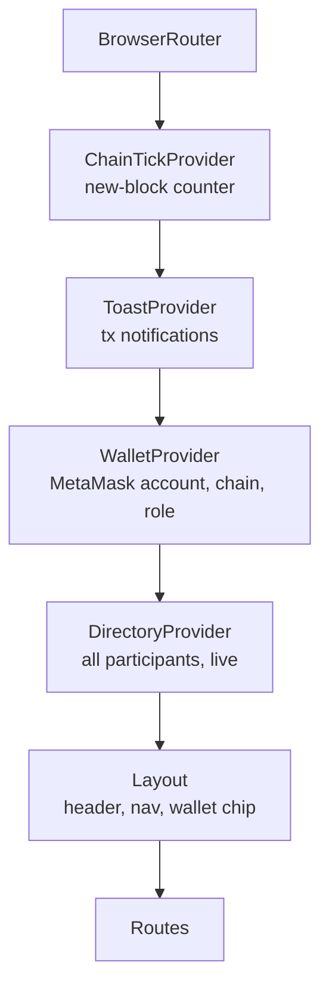

| Path               | Page                    | Guard                                      |
| ------------------ | ----------------------- | ------------------------------------------ |
| `/`                | `Landing`               | public                                     |
| `/verify`          | `Verify` (input)        | public                                     |
| `/verify/:batchId` | `Verify` (result)       | public                                     |
| `/batch/:id`       | `BatchDetail`           | public                                     |
| `/tx/:hash`        | `TxDetail`              | public                                     |
| `/admin`           | `AdminDashboard`        | `RequireRole roles=[Regulator] allowAdmin` |
| `/manufacturer`    | `ManufacturerDashboard` | `RequireRole roles=[Manufacturer]`         |
| `/distributor`     | `DistributorDashboard`  | `RequireRole roles=[Distributor]`          |
| `/pharmacy`        | `PharmacyDashboard`     | `RequireRole roles=[Pharmacy]`             |
| `*`                | `NotFound`              |                                            |

### 7.2 Two ways to talk to the chain

| Path                 | How                                                                    | Used for                                             |
| -------------------- | ---------------------------------------------------------------------- | ---------------------------------------------------- |
| **Read** (no wallet) | `readProvider` = `JsonRpcProvider(RPC_URL)` → `readContract`           | Dashboards, directory, role detection, TxDetail      |
| **Write** (wallet)   | `BrowserProvider(window.ethereum).getSigner()` → `getContract(signer)` | Every state change, through `useTx`                  |
| **Backend**          | `fetch(API_URL + …)` via `lib/api.ts`                                  | Verify page, stats, events, documents, QR/label URLs |

Dashboards deliberately **do not depend on the backend**. They keep working if the API is down. The batch drawer even falls back to direct contract reads if `/api/verify` fails (`useBatchDetail`).

### 7.3 Live updates: `ChainTickProvider`

Every 2 seconds it polls `getBlockNumber()`. When the number changes it increments a `tick` counter. Hooks include `tick` in their dependency lists, so **every view refetches on every new block**. A distributor sees an incoming consignment appear, and a pharmacy sees a verdict flip to RECALLED, without reloading the page.

### 7.4 Libraries (`src/lib`)

| File          | Responsibility                                                                                                                                                                                                                                                                                                                                                                                                                                                                                                              |
| ------------- | --------------------------------------------------------------------------------------------------------------------------------------------------------------------------------------------------------------------------------------------------------------------------------------------------------------------------------------------------------------------------------------------------------------------------------------------------------------------------------------------------------------------------- |
| `config.ts`   | `API_URL` / `RPC_URL` default to **the current browser host** on ports 4000/8545, so a phone on the LAN works without config. Reads `CONTRACT_ADDRESS`, `CHAIN_ID`, `CONTRACT_ABI` from `contracts/RxChain.json`. `txLink()` points to `VITE_EXPLORER_URL` or the built-in `/tx/:hash`.                                                                                                                                                                                                                                     |
| `contract.ts` | `readProvider`, `readContract`, `getContract(runner)`, DTO converters, `fetchBatch`/`fetchBatches`/`fetchIds`/`fetchHistory`/`fetchVerdict`/`fetchChainTime`, and a client-side `computeBatchId` using `solidityPackedKeccak256`.                                                                                                                                                                                                                                                                                           |
| `api.ts`      | Typed backend client. `ApiError` carries the HTTP status; a network failure becomes "Cannot reach the RxChain API at …".                                                                                                                                                                                                                                                                                                                                                                                                    |
| `errors.ts`   | **`decodeError(err)`** turns any wallet, provider or contract error into one sentence: user rejection (code 4001) → "Transaction rejected in MetaMask"; ethers' decoded `revert` or raw revert data found by recursively searching nested error objects → parsed with the ABI → mapped to a friendly message per custom error (e.g. `InvalidTransferRoute(1,3)` → "Transfers from Manufacturer to Pharmacy are not allowed…"); nonce problems → how to reset MetaMask; connection failures → "Is `npm run chain` running?". |
| `verdict.ts`  | Colours, icons, headlines and consumer advice per verdict, plus status badge styles (`Created` is shown as "Held").                                                                                                                                                                                                                                                                                                                                                                                                         |
| `format.ts`   | Address and hash shortening, `en-IN` date and number formatting, `timeAgo`, date-input ↔ unix conversion (local midnight), and **`extractBatchId(text)`**, which pulls a `0x…64` ID out of anything scanned: a full verify URL, a bare ID, or text containing one.                                                                                                                                                                                                                                                          |
| `qr.ts`       | `scanQrFile(file)` decodes a QR from an uploaded image using `html5-qrcode`.                                                                                                                                                                                                                                                                                                                                                                                                                                                |
| `types.ts`    | Frontend types mirroring the backend DTOs.                                                                                                                                                                                                                                                                                                                                                                                                                                                                                  |

### 7.5 Hooks (`src/hooks`)

| Hook                 | What it does                                                                                                                                                                                                                                                                                                                                                                                                                                                                 |
| -------------------- | ---------------------------------------------------------------------------------------------------------------------------------------------------------------------------------------------------------------------------------------------------------------------------------------------------------------------------------------------------------------------------------------------------------------------------------------------------------------------------- |
| `useWallet`          | MetaMask state: silent reconnect on load (unless the user clicked Disconnect, remembered in `localStorage`), `accountsChanged`/`chainChanged` listeners, `connect()`, `switchChain()` (tries `wallet_switchEthereumChain`, falls back to `wallet_addEthereumChain` on error 4902), `getSigner()`. Reads the participant record and `hasRole(DEFAULT_ADMIN_ROLE)` on account change **and on every block**, so a suspension takes effect live. Exports `dashboardPath(role)`. |
| `useTx`              | Runs one contract write with a toast lifecycle: _pending_ ("Confirm in MetaMask…") → _submitted_ (tx hash) → _mined_ (block number) or _error_ (decoded message). Returns the tx hash or `null`.                                                                                                                                                                                                                                                                             |
| `useChainTick`       | Reads the block counter ([§7.3](#73-live-updates-chaintickprovider)).                                                                                                                                                                                                                                                                                                                                                                                                        |
| `useDirectory`       | All participants, refreshed every block; `lookup(address)` puts names next to addresses everywhere.                                                                                                                                                                                                                                                                                                                                                                          |
| `useAsync`           | Generic loader: keeps previous data while refreshing (no flicker), ignores stale responses, exposes `reload()`.                                                                                                                                                                                                                                                                                                                                                              |
| `useBatches(source)` | Loads batch IDs from `getAllBatchIds` / `getBatchesByOwner` / `getBatchesByManufacturer` / `getPendingIncoming`, fetches each batch **and its live verdict**, newest first.                                                                                                                                                                                                                                                                                                  |
| `useBatchDetail(id)` | Full detail via the backend, falling back to direct contract reads.                                                                                                                                                                                                                                                                                                                                                                                                          |
| `useToast`           | Toast queue used by `useTx`.                                                                                                                                                                                                                                                                                                                                                                                                                                                 |

### 7.6 Route guard: `RequireRole`

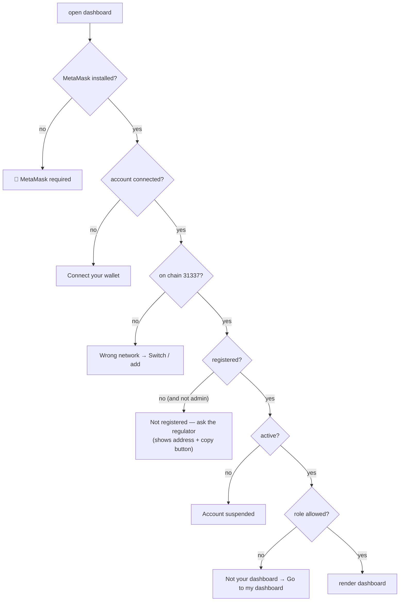

The guard is a **UX convenience, not security**: the contract enforces every rule again. Bypassing the UI just produces a revert.

### 7.7 Pages

#### Landing (`/`)

A hero with **Verify a Medicine** (and **Open my dashboard** when a registered wallet is connected), live ledger stats from `/api/stats` (batches, at pharmacies, in transit, recalled, participants, hand-offs), and a **Recent activity** feed of indexed events rendered as sentences ("MedLine Distributors received from Sun Pharma Ltd").

#### Verify (`/verify`, `/verify/:batchId`)

- **Input mode**, with three tabs:
  - **Scan**: live camera via `html5-qrcode`, preferring the rear camera. It explains clearly if permission is denied or HTTPS is missing.
  - **Upload QR**: decode a photo or a downloaded label PNG.
  - **Paste ID**: a raw ID or a full verify link.

  Whatever is captured goes through `extractBatchId`. Non-RxChain text is still sent to the verifier so the user sees a COUNTERFEIT verdict instead of a silent failure.

- **Result mode**: calls `GET /api/verify/:id` and shows:
  - `VerdictBanner`: large coloured banner, headline, reason and consumer advice;
  - "Checked … against contract 0x…" with **Re-check** and **Verify another**;
  - `BatchInfo`: drug, batch no., manufacturer, dates (expiry highlighted against chain time), quantity, holder;
  - `CustodyTimeline`: every event with icon, participant name, role badge, time, note and a tx link;
  - `DocumentCheck`: upload a CoA → `POST /api/documents/verify` → green "authentic" or red "does NOT match", showing both hashes;
  - for unknown batches, a "What should I do?" card instead.

#### Manufacturer dashboard (`/manufacturer`)

- Stat cards: batches created, in my warehouse, in transit, recalled.
- **Create batch** form: drug name, batch number, quantity, mfg/expiry dates, and an optional CoA upload. The CoA goes to `POST /api/documents` and the returned hash is shown. Before opening MetaMask the form **pre-checks** everything the contract will check: required fields, expiry after mfg, expiry in the future and mfg not in the future (both against **chain time**, not the laptop clock), positive whole quantity, and a duplicate batch number via `computeBatchId` + `fetchBatch`. On success it shows the QR (`QRDisplay`) with Download PNG / Print label links.
- **My batches** table (live, with status and verdict badges). Actions depend on state: **Transfer** (only if you hold it, nothing is pending, it isn't recalled and it isn't expired), **Cancel** (if you have a pending outgoing transfer), **Recall** (with preset reasons, behind an "irreversible" warning).
- `TransferModal` with `allowedRoles=[Distributor]`: the dropdown lists only **active distributors**, so illegal routes aren't even offered.
- Clicking a batch opens `BatchDrawer` (detail, timeline, QR, and **Upload & attach** CoA, shown only to the batch's manufacturer).

#### Distributor dashboard (`/distributor`)

- Stat cards: incoming, inventory, outgoing.
- **Incoming transfers** (`IncomingPanel`): **Confirm** (only after physically checking the goods) or **Reject** with a reason.
- **Inventory**: batches held → **Forward** (`TransferModal` with `allowedRoles=[Distributor, Pharmacy]`).
- **Outgoing (pending)**: waiting for the receiver → **Cancel**.

#### Pharmacy dashboard (`/pharmacy`)

- Stat cards: incoming, **OK to dispense** (verdict GENUINE), **Blocked** (any other verdict, e.g. recalled or expired stock on the shelf).
- **Verify before dispensing**: paste or scan the code on the pack in hand.
- **Incoming transfers**: confirm or reject.
- **Inventory** with the live on-chain verdict per batch and a **Verify** button to the public page. There is no transfer action, because pharmacies are the end of the chain.

#### Regulator console (`/admin`)

- Stat cards: batches, recalled, participants, hand-offs.
- **Register participant**: address (validated), role, licence ID, name, location → `registerParticipant`.
- **Recall any batch**: pick from a list or paste any ID, give a reason → `recallBatch`.
- **Emergency stop**: **Pause** / **Unpause** the contract, with the current state shown.
- **Participants** table with **Suspend** / **Reactivate** per participant (`setParticipantActive`).
- **All batches** table (click for full history) and a **System activity** feed.

#### BatchDetail (`/batch/:id`)

A shareable page with the on-chain record, custody timeline, packaging QR and certificate of analysis. It handles invalid IDs and unknown batches gracefully.

#### TxDetail (`/tx/:hash`)

A **mini block explorer** for local chains, which have no Etherscan. It shows status, block, time, from/to, gas, the **decoded function call** (e.g. `confirmReceipt(0x…)`) and the **decoded events** emitted by RxChain. If `VITE_EXPLORER_URL` is set, tx links go to that explorer instead.

### 7.8 Components (`src/components`)

| Component                                                     | Role                                                                                               |
| ------------------------------------------------------------- | -------------------------------------------------------------------------------------------------- |
| `Layout`                                                      | Header, nav (Verify, my dashboard, Admin), wallet chip with role badge and disconnect, mobile menu |
| `VerdictBanner`, `Badges`                                     | Verdict, status and role visuals                                                                   |
| `BatchInfo`, `CustodyTimeline`                                | Batch facts and the vertical history timeline                                                      |
| `BatchDrawer`                                                 | Slide-over batch detail with attach-document for the manufacturer                                  |
| `TransferModal`, `ReasonModal`                                | Transfer form with a role-filtered receiver list; reason entry with presets (recall/reject)        |
| `IncomingPanel`                                               | Confirm/reject table shared by distributor and pharmacy                                            |
| `QRDisplay`                                                   | QR rendered client-side (`qrcode.react`) + Download PNG / Print label                              |
| `QRScanner`                                                   | Camera scanner lifecycle (start, stop, clear, errors)                                              |
| `DocumentCheck`                                               | CoA hash comparison                                                                                |
| `ActivityFeed`                                                | Indexed events as human sentences with tx links                                                    |
| `DataTable`, `EmptyState`, `Skeleton`, `Modal`/`Drawer`, `ui` | Generic UI kit (buttons, cards, inputs, stat cards…)                                               |
| `AddressChip`, `CopyButton`, `TxLink`, `TxToast`              | Small helpers                                                                                      |

---

## 8. End-to-end: one batch, every layer

This follows the seeded **Paracetamol 500mg · PCM-24001** from the factory to a patient's phone, naming what happens at each layer.

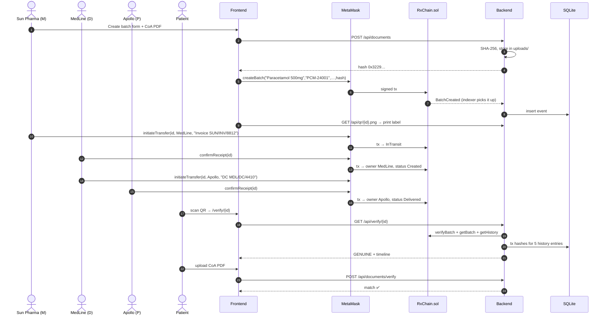

State after each step:

| Step                      | `status`  | `currentOwner` | `pendingOwner` | History length | Verdict         |
| ------------------------- | --------- | -------------- | -------------- | -------------- | --------------- |
| createBatch               | Created   | Sun            | none           | 1              | IN SUPPLY CHAIN |
| Sun → MedLine initiate    | InTransit | Sun            | MedLine        | 2              | IN SUPPLY CHAIN |
| MedLine confirm           | Created   | MedLine        | none           | 3              | IN SUPPLY CHAIN |
| MedLine → Apollo initiate | InTransit | MedLine        | Apollo         | 4              | IN SUPPLY CHAIN |
| Apollo confirm            | Delivered | Apollo         | none           | 5              | **GENUINE**     |
| (regulator recalls)       | Recalled  | Apollo         | none           | 6              | **RECALLED**    |

**What changes the verdict without touching the batch?**

- Suspending Sun Pharma → SUSPICIOUS (manufacturer not authorised).
- Suspending Apollo → SUSPICIOUS (custodian suspended).
- Chain time passing `expiryDate` → EXPIRED.
- Reactivating restores the previous verdict. A recall, however, is permanent.

---

## 9. Where every piece of data lives

| Data                                     | Location                                                                    | Authoritative?        | Rebuildable?                            |
| ---------------------------------------- | --------------------------------------------------------------------------- | --------------------- | --------------------------------------- |
| Participants, roles, active flags        | Contract storage                                                            | ✅ yes                | n/a                                     |
| Batches, custody history, recall reasons | Contract storage                                                            | ✅ yes                | n/a                                     |
| Verdict                                  | Computed by `verifyBatch` (view)                                            | ✅ yes                | Always recomputed                       |
| CoA SHA-256                              | Contract (`docHash`)                                                        | ✅ yes                | n/a                                     |
| CoA files                                | `backend/uploads/<sha256><ext>`                                             | ❌ (verified by hash) | No: keep backups; IPFS/S3 in production |
| Document metadata                        | SQLite `documents`                                                          | ❌                    | Partially (re-upload)                   |
| Event index                              | SQLite `events` + `meta`                                                    | ❌ cache              | ✅ yes, automatically from chain        |
| QR images and labels                     | Rendered per request                                                        | ❌ derived            | ✅ yes                                  |
| Contract address + ABI                   | `frontend/src/contracts/RxChain.json`, `backend/src/contracts/RxChain.json` | n/a                   | ✅ `npm run deploy`                     |
| Participant private keys                 | MetaMask (each participant)                                                 | n/a                   | Never leaves the wallet                 |

---

## 10. Security in brief

The full threat model is in [`SECURITY.md`](SECURITY.md). In summary:

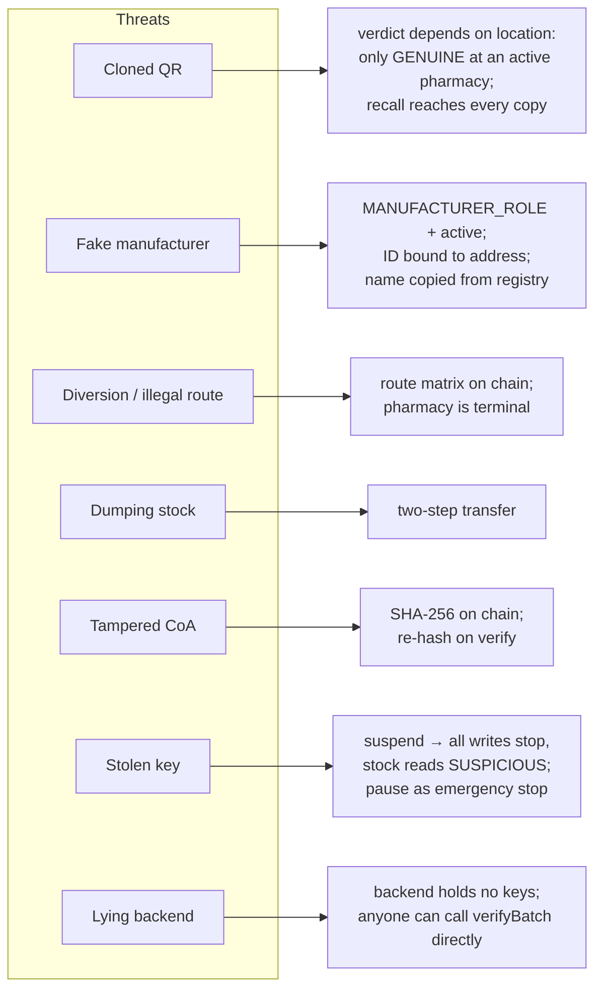

**What blockchain does not solve:** fake pills inside genuine packaging, a licensed manufacturer registering a substandard batch ("garbage in, garbage out"), cloning of a _delivered_ batch's QR (batch-level IDs), off-chain collusion, and privacy on a public chain. Each is discussed with mitigations in `SECURITY.md`.

---

## 11. Testing

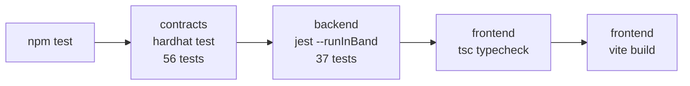

### 11.1 Contract tests (`contracts/test/RxChain.test.ts`)

Run with `npm test -w contracts`. They use Hardhat's in-process network, `loadFixture` and `time.increase`. Suites:

| Suite                       | Covers                                                                                                                                                                                                            |
| --------------------------- | ----------------------------------------------------------------------------------------------------------------------------------------------------------------------------------------------------------------- |
| deployment                  | admin role, regulator registration                                                                                                                                                                                |
| participant registry        | register (all validations), suspend/reactivate, admin-only, revoked roles                                                                                                                                         |
| createBatch                 | role/active gating, empty fields, every date rule, quantity, duplicate ID, indexes, events                                                                                                                        |
| full happy path M → D → P   | verdict at every stage, owner/incoming sets, history                                                                                                                                                              |
| illegal flows               | M→P, M→M, M→Regulator, D→M, P→anyone, unregistered/zero/self/suspended receiver, non-owner or suspended owner initiating, non-pending or suspended confirmer, double initiate, unknown batch ID on every function |
| reject and cancel           | state restored, sets cleaned, authorisation                                                                                                                                                                       |
| recall                      | by manufacturer, by regulator, unauthorised, double recall, pending cleared, empty reason                                                                                                                         |
| documents                   | attach/replace, non-manufacturer, zero hash, history note                                                                                                                                                         |
| expiry                      | initiate/confirm blocked, reject/cancel still allowed, EXPIRED verdict                                                                                                                                            |
| verifyBatch                 | random IDs → Counterfeit; suspended or role-revoked manufacturer and suspended pharmacy → Suspicious                                                                                                              |
| history integrity (harness) | corrupted `from`, injected `Created`, wiped history → Suspicious                                                                                                                                                  |
| pause                       | every write blocked, views still work, admin-only                                                                                                                                                                 |

**The harness.** `contracts/contracts/test/RxChainHarness.sol` extends `RxChain` with test-only functions (`corruptHistoryFrom`, `injectCreatedEvent`, `wipeHistory`) that tamper with storage. This is the only way to reach the "history inconsistent" branch, and it is never deployed by the deploy script. With it, `npm run coverage` reports **100% statements, branches, functions and lines**.

### 11.2 Backend tests (`backend/test`)

- **`globalSetup.ts`** compiles the contract, **spawns a real Hardhat node** on a dedicated port, deploys RxChain, registers test participants and creates one batch per verdict (genuine, in-supply-chain, pending, recalled, and an expired one via `evm_increaseTime`). It writes a deployment file and a fixture file with the IDs and addresses.
- **`api.test.ts`** builds the app with `DATABASE_FILE=:memory:` and a temporary uploads directory, runs one indexer sync, and then tests every route with supertest: health, every verdict, ordered history with tx hashes and names, malformed IDs (`it.each`) → COUNTERFEIT, QR PNG/SVG/download/404/400, the label, document upload/meta/download/verify match and mismatch, size limits, stats, events filters and validation, and unknown routes.
- **`globalTeardown.ts`** kills the node.

### 11.3 Frontend

`npm run typecheck -w frontend` (strict TypeScript) and `npm run build -w frontend` (production bundle with manual chunks for ethers, QR libraries and React).

### 11.4 End-to-end

`npm run e2e` against a running, deployed chain ([§5.6](#56-scriptse2ets)). It also checks the backend's verdicts when the API is up.

### 11.5 Linting and formatting

`npm run lint`: ESLint (typescript-eslint, react-hooks) for backend and frontend, `tsc --noEmit`, and Prettier (with `prettier-plugin-solidity`) in check mode. `npm run format` fixes formatting.

---

## 12. Running and deployment

### 12.1 `npm run demo` (`scripts/demo.mjs`)

1. Probes `RPC_URL` (default `127.0.0.1:8545`) with `eth_chainId`. If a chain is already running it is reused; otherwise it starts `npm run chain` with output in `.demo/chain.log` and waits up to 90 s.
2. Runs `npm run deploy`, then `npm run seed` (exits on failure).
3. Runs `npm run dev` (backend + frontend via `concurrently`).
4. On Ctrl-C it kills the whole process group of every child.

### 12.2 Docker Compose

One image (`Dockerfile`: `node:20-bookworm-slim` + build tools for `better-sqlite3`, `npm ci`, compile contracts, build backend) runs four services:

| Service    | Command                                         | Depends on                        | Notes                                                        |
| ---------- | ----------------------------------------------- | --------------------------------- | ------------------------------------------------------------ |
| `chain`    | `npm run chain`                                 | none                              | Healthcheck: JSON-RPC `eth_chainId`                          |
| `deployer` | `npm run deploy && npm run seed`                | `chain` healthy                   | One-shot; writes deployment files to the `deployment` volume |
| `backend`  | `npm run start -w backend`                      | `deployer` completed successfully | Data in the `backend-data` volume                            |
| `frontend` | copy deployment → `vite build` → `vite preview` | `deployer` completed successfully | Built against the freshly deployed address                   |

### 12.3 Ganache instead of Hardhat

`npm run deploy:ganache && npm run seed:ganache`, then point `RPC_URL` / `VITE_RPC_URL` / `VITE_WALLET_RPC_URL` at port 7545. The `paris` EVM target makes the bytecode compatible. `npm run expire` also works, since Ganache supports `evm_increaseTime`.

### 12.4 Restarting the chain

A Hardhat node keeps its state only in memory. After a restart:

1. `npm run deploy && npm run seed` (the address is the same deterministic one).
2. The backend notices the new `deployedAt` and the changed block hash, and re-indexes automatically.
3. In MetaMask, _Settings → Advanced → Clear activity tab data_ to reset cached nonces.

### 12.5 Towards production

The README's [Limitations](../README.md#-limitations-and-future-work) section covers the path to production: a permissioned chain (Hyperledger Besu) or an L2, a multisig admin, serialised unit-level IDs, GS1 mapping, cold-chain IoT, IPFS/S3 for documents, and paginated listings through the indexer.

---

## 13. Configuration reference

### 13.1 Backend (`backend/.env`)

| Variable          | Default                      | Meaning                                                                                         |
| ----------------- | ---------------------------- | ----------------------------------------------------------------------------------------------- |
| `PORT`            | `4000`                       | HTTP port                                                                                       |
| `RPC_URL`         | `http://127.0.0.1:8545`      | Chain JSON-RPC endpoint                                                                         |
| `PUBLIC_APP_URL`  | `http://localhost:5173`      | Frontend URL encoded in QR codes as `${PUBLIC_APP_URL}/verify/<id>`; use your LAN IP for phones |
| `CORS_ORIGIN`     | `*`                          | Allowed origin(s), comma-separated                                                              |
| `CONTRACT_FILE`   | `src/contracts/RxChain.json` | Deployment file written by `npm run deploy`                                                     |
| `DATABASE_FILE`   | `./data/rxchain.db`          | SQLite file (`:memory:` in tests)                                                               |
| `UPLOADS_DIR`     | `./uploads`                  | Where documents are stored                                                                      |
| `SAMPLES_DIR`     | `../samples`                 | Reference documents imported at startup                                                         |
| `MAX_UPLOAD_MB`   | `10`                         | Upload size limit                                                                               |
| `INDEXER_POLL_MS` | `1000`                       | Indexer polling interval                                                                        |

### 13.2 Frontend (`frontend/.env`)

| Variable              | Default                      | Meaning                          |
| --------------------- | ---------------------------- | -------------------------------- |
| `VITE_API_URL`        | `http://<current host>:4000` | Backend base URL                 |
| `VITE_RPC_URL`        | `http://<current host>:8545` | RPC for read-only queries        |
| `VITE_WALLET_RPC_URL` | `http://127.0.0.1:8545`      | RPC MetaMask is asked to add     |
| `VITE_EXPLORER_URL`   | empty → built-in `/tx/:hash` | External block explorer base URL |

### 13.3 Contract scripts

| Variable                                                    | Used by               | Meaning                                     |
| ----------------------------------------------------------- | --------------------- | ------------------------------------------- |
| `RPC_URL`                                                   | `localhost` network   | Chain URL                                   |
| `GANACHE_URL`                                               | `ganache` network     | Ganache URL                                 |
| `REGULATOR_NAME`, `REGULATOR_LICENSE`, `REGULATOR_LOCATION` | `deploy.ts`           | Admin's registry entry                      |
| `RXCHAIN_FRONTEND_FILE`, `RXCHAIN_BACKEND_FILE`             | `deploy.ts`, `lib.ts` | Override deployment file paths (Docker)     |
| `PUBLIC_APP_URL`                                            | `seed.ts`             | Base for printed verify links               |
| `BATCH_NUMBER`                                              | `expire.ts`           | Which batch to expire (default `IBU-24050`) |
| `BACKEND_URL`                                               | `e2e.ts`              | API to cross-check verdicts                 |
| `GAS_REPORT_FILE`                                           | gas reporter          | Write the gas report to a file              |

---

## 14. Extending the project

**Add a new contract function**

1. Add it to `RxChain.sol` with the right modifiers (`whenNotPaused`, `onlyActive`, `batchExists`) and custom errors. If it changes custody, log exactly **one** history entry and emit exactly **one** event (keep the 1:1 mapping).
2. Add tests, including every revert branch, to keep coverage at 100%.
3. `npm run deploy` regenerates the ABI for both frontend and backend.
4. If you added an event type, add it to `EVENT_TYPE_NAMES` and `HISTORY_EVENT_TO_LOG` (backend `types.ts`), the frontend `types.ts`, `CustodyTimeline`'s `META` and `ActivityFeed`'s describer.
5. Add a friendly message for any new error in `frontend/src/lib/errors.ts`.

**Add a new verdict rule**
Insert it in `verifyBatch` at the right priority (safety before authenticity), extend the `Verdict` enum **at the end** (so existing numeric values don't shift), and update `VERDICT_NAMES` (backend, frontend, scripts) and `VERDICT_STYLE` / `VERDICT_ADVICE`.

**Add an API endpoint**
Create `backend/src/routes/<name>.ts` exporting `xRouter(ctx)`, validate input with zod, wrap the handler in `asyncHandler`, throw `HttpError` for expected failures, mount it in `app.ts`, and add supertest cases.

**Store documents elsewhere (IPFS/S3)**
Only `DocumentStore` touches the filesystem. Swap its `save` / `get` / `pathOf` implementation; the on-chain hash and the verify flow stay the same.

---

## 15. Glossary

| Term                  | Meaning                                                                                                                         |
| --------------------- | ------------------------------------------------------------------------------------------------------------------------------- |
| **ABI**               | Application Binary Interface: the JSON description of a contract's functions, events and errors, used by ethers to encode calls |
| **AccessControl**     | OpenZeppelin module for role-based permissions                                                                                  |
| **Batch / lot**       | A quantity of a drug produced in one manufacturing run, sharing a batch number                                                  |
| **Chain time**        | `block.timestamp` of the latest block; can differ from wall-clock time (and is moved by `npm run expire`)                       |
| **CoA**               | Certificate of Analysis: lab report proving a batch passed QC                                                                   |
| **Custodian**         | Current owner (physical holder) of a batch                                                                                      |
| **Custom error**      | Solidity `error X(args)`, a cheap typed revert reason                                                                           |
| **EIP-1193**          | Standard JavaScript interface between dapps and wallets (`window.ethereum`)                                                     |
| **`eth_call` / view** | Free, read-only contract execution; no transaction or gas payment                                                               |
| **Event / log**       | Data a contract emits in a transaction receipt; cheap to store and easy to index off chain                                      |
| **Hardhat node**      | Local development blockchain with 20 pre-funded accounts                                                                        |
| **keccak256**         | Ethereum's hash function, used for batch IDs and role IDs                                                                       |
| **MetaMask**          | Browser wallet that holds keys and signs transactions                                                                           |
| **Nonce**             | Per-account transaction counter; stale after a chain restart                                                                    |
| **Reorg**             | Chain reorganisation: recent blocks replaced by different ones                                                                  |
| **Revert**            | A failed transaction; all its state changes are undone                                                                          |
| **SHA-256**           | Cryptographic hash used to fingerprint documents                                                                                |
| **Swap-and-pop**      | O(1) removal from an unordered array by moving the last element into the gap                                                    |
| **WDL / RDL**         | Wholesale / Retail Drug Licence (Indian licence categories, used in demo licence IDs)                                           |

---

## 16. FAQ

**Does a consumer need crypto, a wallet or an account?**
No. Verification is a free read (`eth_call`) made by the backend, and the verify page is public.

**Does RxChain cost gas?**
Writes cost gas, paid by the participant who signs. On the local chain the test accounts hold fake ETH. Gas figures are in the README. Verification is free.

**Why is a batch at a distributor not "GENUINE"?**
Because consumers should only buy from pharmacies. If a pack whose batch is still at a distributor is being sold to you, it was diverted or cloned. IN SUPPLY CHAIN tells you the record is authentic but the location is wrong.

**Can a recall be undone?**
No. It is irreversible by design. A mistaken recall would need a new batch.

**What if the backend is hacked?**
It holds no keys, so it cannot change the ledger. It could lie in its responses, but anyone (including the dashboards) can query `verifyBatch` directly from the chain. A production mobile app should call several RPC nodes directly.

**Why do the seeded batch IDs never change?**
IDs are `keccak256(manufacturerAddress, batchNumber)`, and the Hardhat accounts are the same on every fresh node.

**Why does the QR encode a URL instead of the raw ID?**
So a phone's built-in camera app opens the verify page directly. The verifier also accepts raw IDs.

**I restarted the chain and everything broke.**
Run `npm run deploy && npm run seed`, then clear MetaMask's activity data. The backend re-indexes by itself. See [§12.4](#124-restarting-the-chain).

**Why is OpenZeppelin pinned to 5.1?**
Newer versions emit the Cancun `mcopy` opcode, which Ganache 7's EVM does not support. 5.1 with `evmVersion: paris` runs everywhere.
